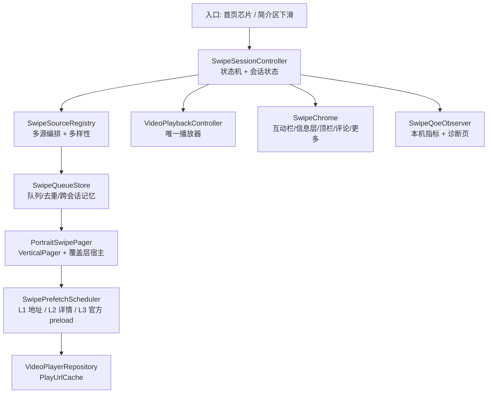

<!-- dsh-html-doc -->
# BBSpace「刷视频模式」全面升级 · 任务书（v2 · 调研定稿版）

> **给接手的 Agent**：这是一份自包含的**架构规格 + UI 规格 + 验收合同**。先读 §1（调研基础与证据等级），再读 §2（现状），否则你会重复劳动或引用过时结论。
>
> 目标一句话：**把 bbspace 的刷视频模式从「BiliPai 对齐版」做到「抖音级沉浸短视频体验」**——翻页即出画面、手势零冲突、信息层自解释、互动闭环、动效有质感、弱网不崩、可观测可回归。
>
> | 项 | 值 |
> |---|---|
> | 仓库 | `D:\111j\c\_ref\bbspace` |
> | 分支 / HEAD | `build/agp9-migration` / `00155991`（工作区干净） |
> | 工具链（**已核实**） | AGP 9.4.0、Kotlin 2.3.20、media3 **1.11.0**、compileSdk 37(+2)、targetSdk 36、**minSdk 33** |
> | 真机 | **当前无设备**（`adb devices` 为空）→ 一切帧率/内存/手感数字本文档不声称 |
> | 本文档 | `docs/2026-10-01-刷视频模式全面升级-任务书.md`（**v2 调研定稿版**，已替换 v1 草稿；决策见 §0.4） |

---

## 0. 导读

### 0.1 必读顺序

| # | 文档 | 拿走什么 |
|---|---|---|
| 1 | 本文 §1 | **证据等级**与**已推翻的旧口径**（不看这节必然引用过时结论） |
| 2 | 本文 §2 | 现状清单 + **C10-ux T1–T5 / 今日 D1–D4 的落地状态**（避免重复劳动） |
| 3 | `docs/ai-loop/analysis-C10-ux.md` | 逐维对照与 **§四「明确不建议做的项」**（硬约束） |
| 4 | `docs/ai-loop/analysis-C10-queue.md` | 数据/队列/去重的 17 行对照表与「不建议移植」7 条 |
| 5 | `docs/ai-loop/analysis-C10-playback.md` | 播放/预取对照与「不建议移植」6 条 |
| 6 | `docs/ai-loop/taskbook-2026-10-01-BiliPai对齐-三阶段升级.md` | **同日任务书**：D1–D4 已做、P/U 两阶段待做；验收口径与工作纪律 |
| 7 | `docs/ai-loop/L4-待真机清单.md` L4-23~L4-28 | 当前挂账的真机项 |
| 8 | `docs/2026-09-28-竖屏刷视频模式-修复任务交接书.md` | 历史根因链（**注意 §5.2 已过时**，见 §1.4） |
| 9 | `feature/video/src/test/.../VideoLogicGuardTest.kt` | 刷视频既有不变式（改动会红的地方） |

### 0.2 术语

| 术语 | 含义 |
|---|---|
| 刷视频模式 / 会话 | 竖屏全屏、上下滑换视频的浏览态；一次进入→退出为一个 session |
| 页 0 / 锚点 | 进入会话那一刻的那支视频 |
| 接力流 | 翻页/播完后按数据源继续追加队列的机制 |
| 交接（handoff） | 封面页 → 播放器页的身份切换与视觉过渡 |
| veil | 等首帧期间盖在播放器上的加载/失败层 |
| L1/L2/L3 预取 | 见 §4.6：播放地址 / 详情 / 媒体数据（官方 preload） |

### 0.3 任务 ID

新增项一律 `SW-xx`（Swipe），不与历史 `C*/B*/F*/U*/T*/ST-*/D*/P*` 抢号。批次：M0 地基 / M1 手感 / M2 信息层 / M3 动效 / M4 场景 / M5 收口（M6 为候选立项，见 §7）。

每项字段固定：**目标｜证据等级｜改动面｜要点｜验收（二值）｜依赖｜风险与回滚｜工作量**。

### 0.4 决策摘要（**已拍板，直接照做，不再回头讨论**）

| # | 议题 | 决定 | 依据 |
|---|---|---|---|
| **D1** | 会话内**单击**语义 | **两条都实现**（显隐控件 / 暂停），**设置默认仍是"显隐控件"**；真机验收通过后再翻转默认（写进 L4 决策点） | 第零约束：凡"只能靠眼睛判"的改动不得改默认行为 |
| **D2** | **长按**语义 | **默认保持"长按=倍速"**；"长按=清屏"作为可选设置项（二选一，互斥），清屏态必有退出途径 | 与 B 站官方一致；清屏在上游**无参照**（仅其直播页有），不冒险改默认 |
| **D3** | L3 媒体数据预热 | **本轮不做**。M0–M5 只做 L1/L2 强化 + 观测；L3 列为 **M6 候选立项** | 无设备无法验证；官方 preload 要求交出建实例权（§4.5.1），风险与收益未证 |
| **D4** | SimpleCache 字节预热 | **本轮不做**，并入 M6 候选（与 D3 同一个立项包） | 磁盘预算、清理 UI、CDN 换线 cache key 三项都需真机数据 |
| **D5** | 播放器架构 | **保持"唯一 PlayerView + `isCurrentVideo` 页身份"**，不转向官方 `PlayerPool` | 池需每页绑 player view，会推翻已验证的页身份模型与既有守卫；收益未证 |
| **D6** | 抖音"音乐碟片" | 用 **UP 头像 + 关注** 替代；长标题用跑马灯 | bbspace 无音乐/BGM 元数据（全仓无该字段） |
| **D7** | 跨会话已推去重 | **默认开**：TTL 7 天、上限 500 条，设置可关 | 防"重复推荐"；可关即安全，且入队前过滤成本极低 |
| **D8** | 稍后再看 / 历史入队 | 稍后再看**可选入队、默认关**；历史**不入队** | 避免信息茧房；历史过滤上游也没做（属共同空白） |
| **D9** | 提交与版本 | 每项一 commit、**只本地不推送**；版本号待真机验收通过后统一 bump | 仓库既定流程（`taskbook-2026-10-01` §5） |

> 以上 9 条**不再列为开放问题**。§10 保留了每条的"复核触发条件"，用于将来有设备时回头推翻。

---

## 1. 调研基础与方法（本节回答"结论从哪来"）

### 1.1 四条调研路径（全部**本机可复核**）

| 路径 | 覆盖 | 产出 |
|---|---|---|
| ① 本仓源码逐文件读 | `feature/video/**`、`core/{feed,playback,model,settings}/**`、`infra/{player,protobuf}/**`、`app/**` | 现状与行号（§2） |
| ② 本仓内部文档台账 | `docs/*.md`、`docs/ai-loop/*.md`（C4/C5/C8/C10 报告、交接书、BACKLOG、PROGRESS、L4、当日任务书） | 已做/未做/挂账/纪律（§2.10、§8） |
| ③ 本地 BiliPai 源码逐能力对照 | `D:\111j\c\_ref\BiliPai`（只读） | 能力差集与移植成本（§3.1） |
| ④ GitHub 直取上游官方源码 | `androidx/media`（`release` 分支） | **官方预加载 API 契约**（§4.5）、字节缓存 API |

### 1.2 工具能力边界（实测，影响结论强度）

| 入口 | 结果 |
|---|---|
| `web_search` | ❌ 401（DeepSeek 搜索端点密钥无效） |
| `web_fetch` / `Invoke-WebRequest` | 部分可达：**GitHub 系（`raw.githubusercontent.com`、`api.github.com`、`github.com`）200 OK**；`developer.android.com`、`en.wikipedia.org`、`google.com`、`r.jina.ai` 全部超时或 SSL 失败 |
| 本地 AutoGLM 搜索服务（skill） | ❌ `127.0.0.1:53699` 连接被拒，不可用 |

**由此产生的硬限制**：本次调研**无法取得抖音/TikTok 官方产品文档、设计规范或工程博客的外部引用**（已专门派出一条外部对标调研流，用 `web_fetch` 逐个尝试可达域名，最终**无可引用产出**）。因此本文档对"抖音行为"的描述一律标注 **C 级（未证实）**，**不得进入硬验收**；凡需要"抖音级"的地方，验收一律改写为**本机可测的内部目标**（§6）。这一点是刻意如此，不是遗漏——**宁可承认没有证据，也不把记忆当来源**。

### 1.3 证据等级定义（本文档每条结论都带等级）

| 等级 | 定义 | 用法 |
|---|---|---|
| **A** | 源码/官方源码直证，能给出 `文件:行号` | 可作为**硬验收**依据 |
| **B** | 本仓内部文档明确记录（含用户真机反馈原话） | 可作为**验收意图**，数字仍需复测 |
| **C** | 行业共识 / 经验推断，无本环境可取的外部来源 | 只作**设计意图**，不得写成"必须 ≤ N ms" |

### 1.4 ⚠️ 调研中已被推翻 / 已失效的旧口径（**不要引用**）

| # | 旧口径 | 事实（证据） |
|---|---|---|
| 1 | "接口以 bilibili-API-collect 为准" | **该仓库 2026-01-28 已永久关停并删除文档**（维护者收到 B 站律师函；`raw.githubusercontent.com/SocialSisterYi/bilibili-API-collect/deprecated/README.md`，A 级）。接口依据 = 仓内 `infra/protobuf/**` + 本地 PiliPlus/BiliPai 实现 |
| 2 | "media3 1.10.1"（2026-09-05 提示词） | 实际 **1.11.0**（`gradle/libs.versions.toml`，A 级） |
| 3 | "minSdk 24，不抬高最低版本" | 实际 **minSdk 33**（`build-logic/.../AndroidApplicationConventionPlugin.kt:35`、`AndroidLibraryConventionPlugin.kt:43`，A 级）。旧文档里的 24 是**过期注释** |
| 4 | 09-28 交接书 §5.2「playurl 预取未移植 / story 流种子已移植」等 | **预取已在 C10 落地**（`PlaybackProgressCache`→`PlayUrlCache` + `VideoViewModel.prefetchSwipeQueue`，A 级）；该表整体作废 |
| 5 | "三个数据源都没有 UP mid" | 错：首页流有 `args.up_id`（`FeedRepository.kt:336`）、story 有 `authorMid`（`StoryFeedItem.kt:21`）；**只有 relate 卡缺 mid**（A 级） |
| 6 | "竖屏过滤没法做（三源无尺寸字段）" | 错：**relate 卡的 proto 里就有 `dimension`**（`common.proto:1240`，`RelateAVCard.dimension = 3`），**只是没解析**；主稿件尺寸在 `view.proto:1171`（`ViewReply.dimension = 36`）。首页 App 流是否带尺寸**待核实**（见 SW-40） |
| 7 | "对标抖音要做到 ≤X ms 首帧" | 无外部来源可证（§1.2）→ 一律转内部目标 + 真机标定（§6） |

---

## 2. 现状盘点（已建成什么，行号已复核）

### 2.1 代码地图与规模

| 文件 | 行数 | 职责 | 备注 |
|---|---|---|---|
| `feature/video/.../player/VideoPlayerPane.kt` | 2328 | 播放器 + 会话覆盖层（veil/信息层/互动栏） | 全仓最大单文件 |
| `feature/video/.../VideoScreen.kt` | 1423 | 详情页/会话宿主（会话启用、方向、系统栏） | 两套语义挤一起 |
| `feature/video/.../VideoViewModel.kt` | 1285 | 详情 + **会话状态寄生**（anchor/queue/tail/prefetch） | 会话状态落点 |
| `feature/video/.../player/PortraitSwipePager.kt` | 623 | pager 编排 + 覆盖层宿主 | 会话核心 |
| `feature/video/.../player/VideoGestureController.kt` | 468 | 单文件手势状态机 | 扩展成本高 |
| `feature/video/.../swipe/*.kt`（10 文件） | ≈900 | **纯逻辑策略**（队列/相似度/预取/补货/交接时序） | 质量最高、JVM 可测 |

### 2.2 三条入口（A 级）

| 入口 | 触发 | 路由 | 会话由谁负责 |
|---|---|---|---|
| 首页顶栏芯片 | 点击（OPPO 无缝 morph，失败回退普通 startActivity） | `EXTRA_STORY_MODE` → `VideoDetailActivity` → `VideoScreen(storyMode=true)` | `bootstrapStorySession()` |
| 详情页简介区边缘下滑 | `pullDownToFullscreen` commit（**唯一置位点**） | 同页全屏 + `swipeSessionActive` | `beginSwipeSession()` |
| 详情页「全屏」钮 | 点击 | 同页全屏 | **不连播**（R3） |

证据：`HomeScreen.kt:336-390`、`VideoScreen.kt:337-360`、`VideoDetailIntents.kt:20/130`、`AppNavHost.kt:276/324`。

### 2.3 数据与队列（A 级）

| 环节 | 现状 | 位置 |
|---|---|---|
| 起步（story 入口） | 首页推荐流 `fetchFeed(idx=0)` 优先，失败兜 story 流 | `VideoViewModel.kt:487-542` |
| 起步（详情全屏） | **仅详情自带 relates**；`beginSwipeSession` 要求 bvid 非空 | `VideoViewModel.kt:434-459` |
| 接力 | 每次新详情的 `relates` 经去重追加（幂等） | `VideoViewModel.kt:213-231` |
| 补货 | 触发阈值 = 倒数第 2 页；最多 3 页凑满 8 条；不足走队尾详情 relates 兜底 | `VideoViewModel.kt:558-635`、`SwipeRefillPolicy.kt` |
| 去重 | 身份键 + 标题全等 + 封面 key + 关键词相似度三档 + 同 UP 12/2 | `PortraitSwipeQueue.kt`、`SwipeSimilarity.kt` |
| 排布 | 新批次固定 seed 洗牌 + 相邻不同 UP（只重排新批次） | `SwipeArrangement.kt` |
| UP 身份 | **用作者名字字符串**；feed/story 侧其实有 mid 未被消费 | `PortraitSwipeQueue.kt:102-118` |
| 时长 | relate 卡 proto 有 `duration`(秒) 与 `duration_text`，**只取了文本** | `VideoDetailRepository.kt:388-389`（proto：`common.proto:1238/1245`） |
| 尺寸 | **完全没解析**（relate/proto 有 dimension；详情有 dimension） | 见 §1.4#6 |
| 负反馈 | `FeedDislikeRepository` 存在，**队列不消费**、`SwipeEntry` 不带 dislikeContext | `core/feed/FeedDislikeRepository.kt`；当日任务书 D2 未做 |
| 稍后再看 / 历史 / 多P / 合集 / 离线 | **均不入队** | — |

### 2.4 播放与预取（A 级）

| 环节 | 现状 |
|---|---|
| 播放器 | **进程级单实例**，`PlayerViewTargetBinder` 绑定；换页 `setSource` + `stopForReuse`；`setKeepContentOnPlayerReset(true)` |
| 页身份 | `SwipeEntry.isCurrentVideo(bvid, aid)`：**aid 优先**、bvid 兜底（字符串 key 会翻转 → 历史事故根因） |
| L1 地址缓存 | `PlayUrlCache`：**容量仅 8 条、TTL 90 秒**；键 = aid#cid#epId#seasonId + 设置摘要（`PlayUrlCache.kt`） |
| L2 详情预热 | 仅 WiFi（`SwipePrefetchPolicy.shouldWarmDetail`） |
| 预取触发 | 拖动跨 25% + 停稳 / 页数变化各触发一次；WiFi+开关 3 条、WiFi 2 条、蜂窝+开关 1 条、否则 0 |
| 提前起播 | `pagerState.currentPage` 在 snap 中点变化即 `onSwipeTo`（已对齐 BiliPai 的 early playback） |
| 连播 | `STATE_ENDED → animateScrollToPage(next)`，带 `lastAutoAdvancedKey` 幂等键；`repeatMode=One` 时不翻页（设计互斥） |
| 失败态 | veil 留着切"错误 + 重试"；重试走 `openVideo`（自增 openId） |
| 首帧竞态 | 引擎 `firstFrameSeq` 归零晚于 ids 发布 → UI 用**粘滞 `waitingKey`** 兜住（C8/C9 已落地） |
| 交接时序 | 遮罩先退 → 干净封面 hold → 交叉淡化 + 1.02→1.0（`SwipeHandoffTiming`，吃 `reduceMotion`） |
| 缺失 | **无 media SimpleCache / 字节预热**；**无 STATE_READY 补踢**；**无 surface 恢复后重绑补踢** |

### 2.5 手势矩阵（A 级）

| 手势 | 当前行为 | 位置 | 会话内 |
|---|---|---|---|
| 上滑/下滑 | 翻页（垂直轴整体让位给 pager） | `VideoGestureController.kt:251-278` | ✅ |
| 斜滑 | 意图宽限 1.5×（会话）/1×（详情），未决期**不消费** | `PlayerDragAxisPolicy.kt` | ✅ |
| 左右滑 | 进度 seek（±60s 上限 + 文字气泡） | `:94/299-307` | ✅ |
| 单击 | `toggleControls`（显隐控件） | `:200-222` | ✅（**与抖音相反**） |
| 双击 | **默认=暂停/播放**；`doubleTapLike` 开启时=点赞+爱心 | `:203-222` | ✅（默认与抖音相反） |
| 长按 | 临时倍速（默认 2x）+ 顶部徽标 | `:182-186/425-437` | ✅（抖音是清屏） |
| 双指捏合 | 1–5x 缩放 + 平移；放大时让位 | `PlayerZoomState.kt:78-163` | ✅ |
| 亮度/音量 | 左右边缘竖向 | `:280-315` | ❌ 已禁用（正确，C10 §四-2） |
| 清屏 | **无**（全仓无此功能；BiliPai 只在**直播**里有 `isPortraitClearScreen`） | — | — |

### 2.6 UI 构成（A 级）

| 区域 | 现状 | 位置 |
|---|---|---|
| 右侧互动栏 | 赞/评/藏/享 4 颗**静态液态玻璃圆盘**，计数在下方；**无头像、无关注、无投币、无更多** | `VideoPlayerPane.kt:1178-1293` |
| 底部信息层 | 常驻 `@UP`（labelLarge）+ 标题（titleMedium，2 行）+ 渐变遮罩；**只读**（无关注/无展开/无话题） | `:800-865`、`:1350-1382` |
| 常驻进度条 | 细进度（屏高 0.35%），**不可点、不可拖** | `:1136-1157` |
| 顶部 | 仅控制条 `showCtrl` 时出现（返回/标题/弹幕/横屏胶囊/更多），2s 自动隐藏 | `:683-798` |
| 等首帧 veil | 封面铺底 + 轻遮罩 + 粒子；**无最短展示时长**；失败→错误+重试 | `:977-1123` |
| 评论区 | **悬浮卡**：固定 0.68 屏高、贴底、点卡外关闭；**不可拖高、无播放器联动** | `PortraitSwipePager.kt:427-473` |
| 收藏 | `ModalBottomSheet` + 复用详情页 `FavFolderSheetContent` | `:475-495` |
| 队列尾部 | "正在为你找更多视频…" / "已经是最后一个了" | `:377-388/520-542` |
| 封面页 | 不裁切 `PlayerPreview + Fit` + 底部渐变标题条 | `:556-622` |
| 无 | 无弹幕输入栏、无会话内搜索、无 Tab、无更多菜单、无分享面板（只有系统分享） | — |

### 2.7 设置项（A 级）

`PlayerPlaybackPrefs`（`PlayerSettingsModels.kt:113-144`）：后台播放 / 播放上报 / 软解 / 解码回退 / 自动横屏 / 长按倍速 / CDN 模式 / **双击点赞（默认 false）** / 无缝 / **预取（默认 true）** / 循环模式 / **播完自动翻页（默认 true）**。

**缺**：仅真竖屏过滤、播完行为枚举、默认静音、蜂窝码率上限、刷视频独立画质记忆、竖屏弹幕独立作用域、启动直达、会话内清屏策略。

### 2.8 工程与测试（A 级）

- 单测 = 纯逻辑 + **源码结构守卫**双轨：`VideoLogicGuardTest`（刷视频不变式，countMatching 按行正则）、`DesignTokenLintTest`、`FrameBudgetLintTest`、`ListAllocationStructureTest`、`AccessibilityStructureTest`、`ColorContrastTest`。
- 棘轮：设计令牌**只许下降**；`animate*AsState` 上限 **9**、`rememberInfiniteTransition` 上限 **2**；designsystem 外禁止新增 `UiStyle.IOS` 判定。
- 工具性事实：**`--rerun` 只在命令行只有一个任务时生效**，多任务会静默全 UP-TO-DATE（当日任务书 §0）。
- 全仓 60+ 测试文件，最新记录 351 单测全绿。

### 2.9 观测（A 级）

**全仓无任何用户行为埋点**（`grep Analytics|埋点|trackEvent` 仅命中 media3 的 `AnalyticsListener` 与玻璃守卫）。会话诊断靠 `Log.i("PortraitSwipe", …)` 手打（`swipe:` / `bind:` / `veil:` / `bootstrap:` / `more:` / `prefetched:`）。
→ 足以 debug，**不足以验收"首帧 P90 多少毫秒"**。

### 2.10 已落地清单（**不要重复劳动**）

| 来源 | 项 | 状态 | 证据 |
|---|---|---|---|
| C10-ux T1 | 封面→首帧交叉淡出（分两段 + 落定缩放） | ✅ 已落地 | `SwipeHandoffTiming.kt`、`VideoPlayerPane.kt:970-1123` |
| C10-ux T2 | 会话内互动栏（4 项）+ 常驻细进度 + 信息层 v2 | ⚠️ 部分（**无头像/关注/更多；进度不可拖**） | `PortraitSwipePager.kt:390-424`、`VideoPlayerPane.kt:1136-1293` |
| C10-ux T3 | 失败重试态 | ⚠️ 部分（**无最短展示时长**） | `PortraitSwipePager.kt:251-292` |
| C10-ux T4 | 相邻页预取（playurl） | ✅ 已落地 | `VideoViewModel.kt:650-701` |
| C10-ux T5 | 设置项补全 | ❌ 未做（连播幂等键已单独落地） | `PlayerSettingsModels.kt:113-144` |
| C10-play Top1 | playurl 进程内 LRU | ✅ 已落地（容量 8/90s，**偏小**） | `PlayUrlCache.kt` |
| C10-play Top2 | 提前起播 + READY 兜底 | ⚠️ 提前起播 ✅ / **READY 补踢 ❌** | `PortraitSwipePager.kt:139-158` |
| C10-play Top3 | media SimpleCache + head 字节预热 | ❌ 未做（**独立立项**） | `Media3PlayerEngine.kt:498-519` |
| C10-play Top4 | mediaId = `bvid#cid` | ❌ 未做 | `Media3PlayerEngine.kt:521-526` |
| C10-play Top5 | surface 恢复补踢 + 卡顿观测 | ❌ 未做 | `VideoPlayerPane.kt:536-553` |
| C10-queue Top1/2/3 | 补货凑满 8 条 / 关键词相似度 / 确定性洗牌 | ✅ 已落地 | `SwipeRefillPolicy.kt`、`SwipeSimilarity.kt`、`SwipeArrangement.kt` |
| C10-queue Top4/5 | 稍后再看入队 / 多P follow-up | ❌ 未做 | — |
| 今日 D1 | `beyondViewportPageCount=1` + 交接分两段 + 轴仲裁宽限 | ✅ 已落地 | `PortraitSwipePager.kt:338-342` |
| 今日 D2 | 会话内「不感兴趣」入口 + `SwipeEntry.dislikeContext` | ❌ 未做（**当日任务书明确挂账**） | 当日任务书 §1-D2 |
| 今日 D3 | 不照抄的上游做法（4 条） | ✅ 已判定 | 同上 §1-D3 |
| 今日 D4 | 蜂窝下详情预热闸门 | ✅ 已落地 | `SwipePrefetchPolicy.shouldWarmDetail` |

---

## 3. 差距矩阵

### 3.1 对 BiliPai（A 级：两侧源码逐条核对）

| # | 能力 | BiliPai | bbspace | 差距 | 成本 | 归属 |
|---|---|---|---|---|---|---|
| B-1 | 互动栏条目 | 赞(**长按**)/币/评/藏(**长按**)/享，计数用 `formatStat` 缩写（`PortraitInteractionBar.kt:77-212`） | 赞/评/藏/享，无投币、无长按、无缩写 | 弱化 | 小 | SW-20 |
| B-2 | 会话内头像 + 关注 | 有（头像 + `@名` + 「关注/已关注」按钮，`PortraitFullscreenOverlay.kt:655-720`） | 无 | 缺失 | 小 | SW-20/21 |
| B-3 | 进度条可拖 | 有（`pointerInput` + onSeek/dragStart/Update/Cancel + 拖动 thumb 放大，`PortraitProgressBar.kt:50-270`） | **不可拖** | 缺失 | 中 | SW-15 |
| B-4 | seek 预览 | `CompactSeekPreview` + **VideoshotData 雪碧图**（`SeekPreviewBubble.kt:363-414`） | 无 | 缺失（**C10 §四-1 判定不做**） | 大 | ⛔ |
| B-5 | 常驻底部细进度 | `PersistentBottomProgressBar`（`PortraitFullscreenOverlay.kt:389`） | ✅ 已有等价物 | 等价 | — | — |
| B-6 | 评论区形态 | 高度分数驱动展开 + **播放器随展开缩放** + 拖动 ≥22% 关闭 + 二级/回复宿主（`PortraitCommentPresentationPolicy.kt:44-210`） | 固定 0.68 屏高、无拖动、无缩放联动 | 弱化 | 中 | SW-23 |
| B-7 | 会话内输入栏 | `PortraitBottomInputBar` + 弹幕 chip + 字幕 chip（`PortraitFullscreenOverlay.kt:282-345`） | 无（评论输入在评论卡内） | 弱化 | 中 | SW-23/24 |
| B-8 | 竖屏弹幕独立作用域 | `DanmakuSettingsScope.PORTRAIT` + `PortraitDanmakuDisplayAreaMode`（`SettingsManager.kt:922-1009/4894-5056`） | 单一 `DanmakuConfig` | 缺失 | 中 | SW-27/50 |
| B-9 | 竖屏过滤 | tri-state + 逐条探测（默认**关**）；另有 **封面比例推断** `inferVerticalVideoFromCoverUrl`（`VideoVerticalInferencePolicy.kt:3-14`）+ `vertical_video_ratio` 阈值 | 无 | 缺失（**但 proto 有 dimension**，见 §1.4#6） | 小 | SW-40 |
| B-10 | 字节级预热 | `PlaybackMediaCache`（SimpleCache 512MB + `prefetchRange`，`PlaybackMediaCache.kt:106-193`；消费于 `PortraitVideoLoadPolicy.kt:428`） | 无 | 缺失 | 大（内核级） | SW-12/L3 |
| B-11 | letterbox 环境光 | `captureVideoAmbientFrame`(PixelCopy)（`PortraitVideoPager.kt:2364`、`VideoPlayerSection.kt:1385`） | 无 | 缺失（**C10 §四-3 判定不做**） | 中 | ⛔ |
| B-12 | 竖屏播放器折叠模式 | `PortraitPlayerCollapseMode`（OFF/INTRO_ONLY…，`SettingsManager.kt:393-421`） | 只有 `showCtrl` 2s 自动隐藏 | 弱化 | 小 | SW-25 |
| B-13 | 双指上下滑调速 | `two_finger_vertical_speed_enabled`（`SettingsManager.kt:1139/2934`） | 无 | 缺失 | 小 | SW-26（可选） |
| B-14 | 播完行为枚举 | 五态 `PlaybackEndAction` + repeat 解耦（`PlaybackCompletionPolicy.kt:20-81`） | 一个开关 + `repeatMode` | 弱化（**C10 §四-1 不做五态**） | 小 | SW-14（只做二态） |
| B-15 | 稍后再看入队 | 有（`PortraitVideoPager.kt:547-593`） | 无 | 缺失 | 中 | SW-41 |
| B-16 | 多P follow-up 注入 | 有（仅多P，season 故意不做，`PortraitCollectionPolicy.kt:7-47`） | 无 | 缺失 | 中 | SW-41 |
| B-17 | mediaId = `bvid#cid` | 有（`PortraitPagerSwitchPolicy.kt:75-78`） | 无（aid 级身份） | 缺失（详情多P 有风险） | 小 | SW-41 |
| B-18 | surface 恢复补踢 | `shouldKickPlaybackAfterSurfaceRecovery` + 延迟重试（`PortraitVideoPager.kt:1955-1983`） | 无 | 缺失 | 小 | SW-52 |
| B-19 | 卡顿→换线恢复 | `PlaybackStallRecoveryPolicy`（有单测） | 无（有 60s/3 次会话重建闸门） | 弱化 | 小 | SW-44 |
| B-20 | 竖屏启动直达 / 上滑进全屏 | 3 个设置项（`SettingsManager.kt:1098/1142-1143`） | 仅首页顶栏入口 | 缺失 | 小 | SW-50 |
| B-21 | story 入口三态 | loading/error(重试)/empty(重试)（`StoryScreen.kt:98-119`） | 直接进会话（封面+粒子），无入口级态 | 等价/更优 | — | — |
| B-22 | 首帧判定 | generation 相等判定（`PortraitVideoPager.kt:1034/786-789`） | UI 粘滞键（末端缓解） | **等价**（C10 §四-6 不做改造） | — | ⛔ |
| B-23 | 截图 | v0.2.3.5 新增（`34d189620`） | 无 | 缺失（记 BACKLOG AF-01） | 中 | 不在本轮 |
| **反超** | 唯一播放器 + 页身份按内容比 | 每页持 PlayerView、换视频重建 surface | **bbspace 更优**（`PortraitSwipePager.kt:68-94`） | 保护 | — | 铁律 |
| **反超** | 封面铺底（当前页也铺） | 当前页黑底硬切 | **bbspace 更优** | 保护 | — | 铁律 |
| **反超** | 会话内评论不盖全屏 | 弹层式 | **bbspace 悬浮卡更贴合短视频心智** | 保护 | — | 铁律 |

### 3.2 对"抖音级体验"（C 级：无外部来源，作设计意图）

| # | 期望体验 | bbspace 现状 | 归属 |
|---|---|---|---|
| D-1 | 翻页即出画面（预取命中近乎无等待） | 靠 L1 地址 LRU（8 条/90s，偏小）+ 提前起播；无媒体字节预热 | SW-12 |
| D-2 | 上滑 1:1 跟手、翻页有位移/缩放的"带走感" | Pager 默认跟手；无出页位移/缩放 | SW-10 |
| D-3 | 单击暂停、双击点赞（默认） | 单击=显隐控件、双击=暂停 | SW-26（**D1：两条都做、默认仍为显隐控件**） |
| D-4 | 长按清屏（隐藏所有 UI） | 长按=倍速 | SW-25（**D2：默认仍为倍速，清屏为可选设置**） |
| D-5 | 右侧：头像+关注、赞/评/藏/享/更多 | 4 颗按钮，无头像无关注无更多 | SW-20 |
| D-6 | 底部：作者行+关注、文案可展开、话题 | 只读两行 | SW-21 |
| D-7 | 顶部：返回 + 搜索 + 推荐/关注切换 | 仅控制条里的返回 | SW-22 |
| D-8 | 评论半屏、可拖高、播放器联动缩放 | 固定高度悬浮卡 | SW-23 |
| D-9 | 进度条可拖 + 时间气泡；拖动时暂停自动翻页 | 不可拖 | SW-15 |
| D-10 | 爱心粒子 / 计数滚动 / 关注形变 / 加载体系 | 单颗爱心 + 淡出 | SW-30~34 |
| D-11 | 弱网降码率 + 提示 + 恢复 | 有 CDN/缓冲档与失败重试；无弱网提示 | SW-44 |
| D-12 | 不感兴趣 → 立即消失并补一支 | 通道在、会话内无入口 | SW-24 |
| D-13 | 连续刷 50 条不崩不卡 | 无长会话专项 | SW-52 |
| D-14 | 无障碍可用（读屏/大字号/降动效） | 覆盖层未专项验证 | SW-51 |

### 3.3 补充：调研中记下的其他挂账（来自内部文档台账，B 级）

| 项 | 描述 | 阻塞 | 归属 |
|---|---|---|---|
| PF-02 | **单文件 DASH 预取窗口固定 91,536 字节**，索引超出即起播失败（`BACKLOG.md:79`） | 需真实索引分布/抓包 | SW-52 |
| story 流失败 | 失败**静默降级单视频**，无重试 UI（`report-C5:67-69`） | 低优先 | SW-13 |
| 深链 onNewIntent | 深链在会话中打开会打断当前会话且残留状态（`report-C5:69-71`） | 需真机 | SW-52 |
| 真机未跑 | 「播完只前进一支」「队列到底提示」两项当时**未跑到**（`report-C10:248,250`） | 需长视频/滑十几屏 | SW-14 |
| 预取真机复测 | 拖动分支只有"机制通过"，未验证是否真省掉往返（`report-C10:220-231,246`） | 需真机 | SW-12 |
| 上游 av2bv | 上游 `av2bv(2)` 的自带单测**与实测/live API 不一致**，旧模板算法对新版长 aid 会算出别的视频（`report-C7:32-36,105-113`） | 不可照抄 | SW-04 |

---

## 4. 目标架构

### 4.1 分层与数据流



四条原则：**纯逻辑下沉可测**、**UI 留在 feature**、**播放内核不重做**、**单一真值源**。

### 4.2 模块与包（决策：方案 C）

| 方案 | 内容 | 结论 |
|---|---|---|
| A | 只在 `feature/video` 内整理 | 否：`core/feed` 的多源编排拿不到纯逻辑 |
| B | 新建 `feature/swipe` | 缓：收益不抵成本（`VideoDetailActivity` 要同时依赖两个 feature 模块） |
| **C（选）** | 新建 **`core:swipe`**（纯 Kotlin/Android library，无 Compose）+ UI 留 `feature/video/swipeui` | **采纳**：符合 `feature → core → infra`，JVM 可测，零 UI 迁移风险 |

```
core/swipe/                                   ← 新模块
  model/SwipeId.kt          model/SwipeEntry.kt
  session/SwipeSessionState.kt  session/SwipeSessionController.kt
  queue/SwipeQueuePolicy.kt     queue/SwipeSeenStore.kt
  source/SwipeSource.kt         source/SwipeSourceRegistry.kt
  prefetch/SwipePrefetchPolicy.kt  handoff/SwipeHandoffTiming.kt
  qoe/SwipeQoeMetrics.kt
feature/video/swipeui/
  SwipeChrome.kt  SwipeActionRail.kt  SwipeBottomInfo.kt
  SwipeCommentSheet.kt  SwipeMoreSheet.kt  SwipeSeekBar.kt
```

**迁移两步走（可单点回滚）**：① 纯搬运（文件移动 + 包名替换，**行为零变化**，独立提交）；② 在其上增强。

### 4.3 会话状态机（SW-02）

```kotlin
sealed interface SwipeSessionState {
    data object Idle : SwipeSessionState
    data class Bootstrapping(val via: SwipeEntryVia, val anchor: SwipeEntry) : SwipeSessionState
    data class Ready(val page: Int, val size: Int) : SwipeSessionState
    data object Extending : SwipeSessionState                 // 仅停在最后一页时示意
    data object Exhausted : SwipeSessionState
    data class PlaybackFailed(val id: SwipeId, val retryable: Boolean) : SwipeSessionState
}
```

事件：`Enter(seed, via)` / `QueueUpdated` / `PageChanged` / `RefillStarted|RefillResult(appended)` / `PlaybackError(retryable)` / `Retry` / `Exit`。

**不变式（写进单测）**：
1. `Bootstrapping` 期间 UI 必显示封面 + 粒子（**不得黑屏**）——由状态派生，不再由各调用点自判。
2. `Retry()` 后必回 `Ready`；`retryable=false` 时重试按钮禁用（去抖）。
3. `Exit()` 必清空 anchor/queue/tail/**预取去重表/自动翻页幂等键**（后者清空是历史 bug 的预防）。
4. 进程重建后恢复为 `Ready`（页号 + 队列 + 锚点），**不重放网络请求**。

### 4.4 身份键与条目模型（SW-03 / SW-04）

```kotlin
sealed interface SwipeId {                       // aid 优先、bvid 兜底（语义与现状一致）
    data class Av(val aid: Long) : SwipeId
    data class Bv(val bvid: String) : SwipeId
    data class Both(val aid: Long, val bvid: String) : SwipeId
    data class Media(val bvid: String, val cid: Long) : SwipeId   // 为多P/合集预留（SW-41）
    fun matches(current: SwipeId?): Boolean
}
```

**为什么值得做（A 级）**：`PortraitSwipeQueue.kt:56-80` 用了 20 行注释解释"字符串在取流完成时会翻转"——这正是"能滑不能播"真机事故的根因（C7）。类型化后"去重键"与"页身份"在编译期分开；`legacyKey()` 仅供日志与 map。

条目模型补全（**每一项都标数据来源可用性**）：

| 字段 | feed 源 | story 源 | relate 源 | 详情（当前页） | 证据 |
|---|---|---|---|---|---|
| `ownerMid` | ✅ `args.up_id` | ✅ `authorMid` | ❌ 缺 | ✅ `owner.mid` | `FeedRepository.kt:336`、`StoryFeedItem.kt:21` |
| `durationSec` | ❌ | ✅ `durationSec` | ✅ **proto 有 `duration`(秒)**，只是没解析 | ✅ | `common.proto:1238`、`VideoDetailRepository.kt:388-389` |
| `dimension`（宽高/rotate） | 待核实（App 流 JSON） | 待核实 | ✅ **`RelateAVCard.dimension`** | ✅ `ViewReply.dimension=36` | `common.proto:1240`、`view.proto:1171` |
| `dislikeContext` | ✅ | ❌ | ❌ | — | `FeedItem.kt:24/94-106` |
| `author` | ✅ | ✅ | ✅ | ✅ | — |

→ **结论：竖屏过滤与时长判据是"proto 里已有字段、解析未做"的成本**，不需要新接口，更不需要逐条探测详情（C10-queue §四-2 明确反对探测）。

⚠️ **av2bv 陷阱**：relate 的 bvid 靠本地 `avToBv` 补（`PortraitSwipeQueue.kt:170-172`）。上游的自带单测与实测不一致，**不得照抄上游实现**；补 `bvid` 后必须与"取流后服务端解析出的 bvid"做一致性断言（已有先例：`VideoLogicGuardTest` 的 bvidFilled 日志）。

### 4.5 播放内核决策（**本节是 v2 相对 v1 的最大修改**）

| 方案 | 收益 | 成本/风险 | 结论 |
|---|---|---|---|
| 保持单实例 + 强化 L1/L2 | 零回归；保住"唯一 PlayerView + isCurrentVideo"优势 | 最快仍受"停稳后取流+解码"限制 | ✅ **基线** |
| **无界追加第二个 ExoPlayer 常驻** | 理论零等待 | 第二份解码器/Surface；后台抢 codec；音频焦点与上报表需去重；**违反"不得引入第二个 PlayerView 常驻节点"铁律** | ⛔ **否决** |
| **官方 `PlayerPool`(media3-common-ktx) + `rememberPooledPlayer`(media3-ui-compose)** | 这是 **1.11.0 官方短视频范式**（`demos/shortform` 用 `DefaultPreloadManager + PlayerPool` 并用） | 池要求"每页绑定一个 player view"，与 bbspace 的"唯一 PlayerView + `PlayerViewTargetBinder`"模型**直接冲突** | ⛔ **本轮不采用（D5）**：保持唯一 PlayerView；仅在 L1/L2 与字节预热都到平台期后才重评 |
| **官方预加载**（`PreloadMediaSource` + `DefaultPreloadManager`）**配现有单实例** | 预载 MediaSource/MediaPeriod，**不解码、不占 codec、不需要第二个 Surface**；与真播仍是同一个 ExoPlayer，`PlayerViewTargetBinder` 不动 | `@UnstableApi`；**必须交出 ExoPlayer 建实例权**（见 §4.5.1）；命中条件苛刻（起点必须一致）；错误不入现有恢复链路 | 🅿️ **SW-12 的 L3，默认关、单独立项** |
| **纯字节预热**（`CacheWriter` + `CacheDataSource` + `SimpleCache`） | 对现有 player 结构**零侵入**；解决"重看不省流量、首段要下载" | 磁盘预算 + 清理 UI + CDN 换线 cache key | 🅿️ **独立立项（Q4）** |
| **L2.5 仅字节预热不做 player 改造** | 上面一条的保守版：只预写 head 若干字节 | 收益小于 preload（解码仍未预热） | ✅ **L1/L2 到平台期后的第一选择** |

**证据（A 级，androidx/media `release`，2026-10-01 抓取）**：`libraries/exoplayer/src/main/java/androidx/media3/exoplayer/source/preload/PreloadMediaSource.java`（类注释"Preloads a MediaSource and provides a MediaPeriod that has data loaded before playback"）、同目录 `DefaultPreloadManager.java`/`BasePreloadManager.java`/`TargetPreloadStatusControl.java`/`RankingDataComparator.java`/`PreCacheHelper.java`；`libraries/common-ktx` 的 `PlayerPool`、`libraries/ui-compose` 的 `rememberPooledPlayer`、`demos/shortform/**`（**官方短视频 demo 同时用两者的证据**）；`RELEASENOTES` 1.11.0（PlayerPool 发布）。

> ⚠️ **自我修正**：v2 初稿写的"`PlayerId.PRELOAD` 有**独立 allocator 预算**"**不准确**。复核结论：`allocator = loadControl.getAllocator(PlayerId.PRELOAD)`，而 `DefaultLoadControl.getAllocator` 返回的是按 PlayerId **记账**的包装（底层仍是**同一个** `DefaultAllocator`）；"独立预算"实际来自 **按 player 名 `"preload"` 的 target buffer 配置**（`setPlayerTargetBufferBytes("preload", N)`），不是硬隔离——**预加载与播放会互挤同一块内存池**。这直接影响 L3 的默认参数（见 §4.5.1）。

#### 4.5.1 官方 preload 的落地硬约束（A 级；不满足则不要做）

1. **必须交出 ExoPlayer 建实例权**：player 只能由 `DefaultPreloadManager.Builder(...).buildExoPlayer(existingBuilder)` 产出（外部 builder 可保留 `setWakeMode` 等）。bbspace 现有 `Media3PlayerEngine.buildPlayer`（`Media3PlayerEngine.kt:330-355`）与 `ensurePlayer`/`updateConfig`/`recoverSession` 三条建实例路径（`:186/:418/:381`）**必须收敛为一个 builder**。
2. **播放线程必须 = 预加载线程**，否则 `IllegalStateException`（`DefaultLoadControl` + RELEASENOTES 1.8.0）。preload looper **不得是 main**；ExoPlayer 默认 playbackLooper 本就是新建线程 → 只能共用同一 `PlaybackLooperProvider`。
3. **命中条件 = `MediaPeriodKey` 相等（忽略 windowSequenceNumber）且 `startPositionUs` 相等** → **真实 prepare 的起点必须与 `preload(startPositionUs)` 完全一致**，否则预加载白做（"续播进度"场景尤其危险：`resumePositionMs` 回填后会变）。
4. `LoadControl` / `TrackSelector` / `BandwidthMeter` / `RenderersFactory` 必须与 player **同源同实例**。
5. 预载深度用 `TargetPreloadStatusControl` 分档（官方 demo：邻近页 `specifiedRangeLoaded(1000ms)`、其余 `specifiedRangeCached(5000ms)`），`PreloadStatus` 五档：`NOT_PRELOADED / SPECIFIED_RANGE_CACHED / SOURCE_PREPARED / TRACKS_SELECTED / SPECIFIED_RANGE_LOADED`；返回 null = 不预加载。
6. 生命周期：`addMediaItems(items, indexes)` → 翻页只 `setCurrentPlayingIndex(i)`（内部自动 invalidate）；越界页 `removeMediaItems`；踢播 = `getMediaSource(item)` → `player.setMediaSource(...)` → `prepare()`。
7. **预加载错误不会触发** bbspace 现有的 `rebuildGen`/`RebuildThrottle` 恢复链路（`Media3PlayerEngine.kt:363-399`），要走 `PreloadManagerListener.onError` 单独处理；**预加载事件也不会出现在现有 `AnalyticsListener`**（PlayerId 不同）→ 观测必须另接（与 SW-06 联动）。
8. 预算与抢占：`onLoadingUnableToContinue` 触发时 manager 默认清理**最低优先级**源；**不要**在自定义实现里轻易返回 true。
9. "翻页即出画面"仍有天花板：preload 只保证 **数据/轨道就绪**，**不保证解码与首帧**——首帧仍需真播时解码。这是 L3 的真实收益边界，不要承诺"零等待"。
10. 若只想零侵入：走 `CacheWriter`（`dataSpec.setPosition(0).setLength(N)` 即"只取 head N 字节"；`cancel()` 后可断点续传；**官方无专门 head-N API**）+ `CacheDataSource`，缓存 key 必须用 `DataSpec.key` 钉死（不同 range 同 key），换线数据源要放在 `CacheDataSource` **之下**；`SimpleCache` 单例（同目录第二实例抛异常），初始化失败必须捕获降级直连。

**落地阶梯（必须按序）**：① L1 容量/TTL 调优 + 触发时机 → ② L2 分层 → ③ 用 QoE 证明"L1/L2 已到平台期"→ ④ 字节预热（零侵入）→ ⑤ 才评估官方 preload（需先接受第 1/2 条的交权）。

### 4.6 预取三层与网络矩阵（SW-12）

| 层 | 内容 | 现状 | 升级 |
|---|---|---|---|
| L1 | playurl 进程内 LRU | ✅ 容量 **8 条 / TTL 90s** | **容量与预取矩阵不匹配**：WiFi+开关预取 3 条 + 当前页 + 回看即可能触顶；调容量/TTL 需与 `resumePositionMs` 陈旧风险权衡（`PlayUrlCache.kt` 注释） |
| L2 | 详情预热（标题/UP） | ✅ 仅 WiFi | 分层：WiFi 全量；蜂窝可选"仅轻字段"（受省流开关，默认关） |
| L3 | 媒体数据预热 | ❌ | 见 §4.5/§4.5.1：先**零侵入字节预热**（`CacheWriter` head N + `CacheDataSource`），再评估**官方 preload**（需交出建实例权）；两者默认关、独立立项 |

矩阵（纯函数可测）：WiFi+开关 3 / WiFi 2 / 5G 2 / 4G 1 / 弱网 1+降码率 / 无网 0（只播离线）。
**必须补的判据**：`shouldCancelPrefetch(网络切换 / 用户回滑 / 队列变更)`——现状无取消语义。

### 4.7 数据源编排（SW-05）

```kotlin
interface SwipeSource {
    val id: String            // home-feed / story / relates / watch-later / history / offline
    val cost: SwipeSourceCost // 流量成本（决定蜂窝可用性）
    val diversity: Float      // 多样性权重
    suspend fun next(cursor: SwipeCursor, limit: Int): List<SwipeEntry>
}
```

规则（纯函数）：① 首页推荐流优先，不足按 `cost` 升序补 relates → story；② 去重统一在 `SwipeQueuePolicy`（源内不各自去重）；③ 多样性硬约束（12 条内同 UP ≤2 **改用 mid**、同封面 ≤1、关键词三档沿用）；④ **跨会话已推库命中即丢**（SW-05b，`SwipeSeenStore`，LRU N 条 + 有效期）；⑤ 负反馈即时生效（移除 + 补 1 条 + 若当前页则自动前进）；⑥ 稍后再看/历史默认关（避免信息茧房）。

### 4.8 观测（SW-06）——本机版

| 项 | 规格 |
|---|---|
| 事件 | enter / exit / page / first_frame / play_error / rebuffer / prefetch / refill / handoff / gesture（仅计数） |
| 存储 | 内存环形缓冲（N=500）+ 可选本机文件；**不联网、无第三方 SDK** |
| 指标 | 首帧 P50/P90/P99、滑页成功率、预取命中率、交接时长、卡顿次数/千次播放、补货净增 |
| 出口 | 设置 →「刷视频诊断」页（表格 + 导出文本）；debug 可选浮层 |
| 隐私 | **不采集标题/UP/账号/设备标识**；aid 哈希默认关 |
| 价值 | 让 §6 的目标从"猜"变"可测"——这是"无设备也能写数字口径"的唯一前提 |

### 4.9 设计系统与硬约束（继承）

token（颜色/字号/间距/圆角/动效）、常驻控件禁真背景模糊、`reduceMotion`、**不新增 dp/sp 字面量**、composable 体禁就地 `val xShape=`、不新增 `rememberInfiniteTransition`、动画值在 draw/graphicsLayer 里读、designsystem 外禁新增 `UiStyle.IOS` 判定。

---

## 5. 任务分解

> 每项格式：**目标 / 证据等级 / 改动面 / 要点 / 验收 / 依赖 / 风险回滚 / 工作量**。工作量单位 = 代理轮次（1 轮 ≈ 一次"读—改—编译—单测"闭环）。

### M0 · 地基（架构，先做；本批**不改任何用户可见行为**）

#### SW-01 `core:swipe` 模块落地（纯搬运）
- **目标**：把会话纯逻辑从 `feature/video/swipe` 与 `VideoViewModel` 迁到 `core:swipe`，**行为零变化**。
- **证据**：A（现状文件清单见 §2.1）。
- **改动面**：新增 `core/swipe/**`；改 `settings.gradle.kts`；`feature/video` 改为依赖 `core:swipe`；删旧文件。
- **要点**：① `SwipeEntry` 连带 `isCurrentVideo/key` 一起搬；② 单测跟着搬（`PortraitSwipeQueueTest`/`SwipeSimilarityTest`/`SwipePrefetchPolicyTest`/`SwipeRefillPolicyTest`/`SwipeHandoffTimingTest`/`SwipeArrangementTest`）**一条不改**；③ 先在本地验证 `:core:swipe:testDebugUnitTest --rerun`（**单任务**）。
- **验收**：`:app:assembleDebug` 通过；`feature:video` 与 `core:swipe` 单测全绿且**测试数量不减**；`git diff` 显示旧文件删除 + 纯搬运；无任何行为断言变更。
- **依赖**：无。**风险**：包名/Hilt 注入点遗漏。**回滚**：整段 revert（单提交）。
- **工作量**：1–2 轮。

#### SW-02 会话状态机
- **目标**：会话状态收敛为 §4.3 的单一真值源；进程重建可恢复；错误态统一。
- **证据**：A（散落现状：`VideoViewModel.kt:147-154/471-476/558-609`、`VideoScreen.kt:332-363`、`PortraitSwipePager.kt:138/216/273`）。
- **改动面**：新增 `session/SwipeSessionState.kt`、`session/SwipeSessionController.kt`（+单测）；改 `VideoViewModel` 的会话段为 Controller 委托；`VideoScreen` 用 `SavedStateHandle` 恢复。
- **要点**：状态派生 UI（Bootstrapping → 封面+粒子），**不新增控件**；`Exit()` 清理幂等键；不改变既有入口判据（R1/R2/R3 不动）。
- **验收**：状态机单测（含 4 条不变式 + 进程重建恢复）；`VideoLogicGuardTest` 仍全绿（或按 §8.4 同步更新并说明）。
- **依赖**：SW-01。**风险**：与 `rememberSaveable` 的双份状态打架 → 迁移期只允许一处写。**回滚**：Controller 旁路开关。
- **工作量**：2 轮。

#### SW-03 类型化身份键 `SwipeId`
- **目标**：消除"字符串 key 当页身份"的 bug 类；为多P/合集预留 `Media(bvid,cid)`。
- **证据**：A（`PortraitSwipeQueue.kt:56-94`；C7 事故根因）。
- **改动面**：`SwipeEntry.key: String → id: SwipeId`；全链路调用点改造；`legacyKey()` 仅日志/去重 map；新增"`SwipeEntry` 不得再有 `key: String`"的源码守卫。
- **要点**：`isCurrentVideo` 语义**必须逐条对齐现状**（aid 优先、bvid 兜底）并保留"C7 回归"单测；`openSwipeTarget` 的短路判据同步。
- **验收**：`PortraitSwipeQueueTest` 的 aid/bvid 兜底用例全绿；新增守卫；真机项（翻页起播）进 L4。
- **依赖**：SW-01。**风险**：改造面广 → 分两个提交（模型 + 调用点）。**回滚**：保留 `legacyKey` 兼容层。
- **工作量**：2 轮。

#### SW-04 条目模型补全（mid / durationSec / dimension / dislikeContext）
- **目标**：把"proto 里已有、没解析"的字段接出来（§4.4 表）。
- **证据**：A（`common.proto:1238/1240`、`view.proto:1171`、`FeedRepository.kt:336`、`StoryFeedItem.kt:21`、`VideoDetailRepository.kt:388-389`）。
- **改动面**：`SwipeEntry` 增 `ownerMid: Long?`、`durationSec: Int?`、`dimension: SwipeDimension?`、`dislikeContext: FeedDislikeContext?`；`VideoDetailRepository.mapRelates` 增 `duration`/`dimension` 解析；`VideoDetail` 增 `dimension`；各 `swipeEntryFrom*` 填充。
- **要点**：① **不引入新接口**；② `dimension` 的 proto 路径需实测确认（`RelateAVCard.dimension` 是 `playershared.Dimension`）；③ 首页 App 流的 dimension **需先核实**（dump 一次响应找 `dimension|width|height`；找不到就留 null 走回填策略）；④ `dislikeContext` 仅 feed 源有（relate/story 源为 null → UI 按 null 隐藏入口，不做假按钮）。
- **验收**：单测覆盖"三源映射出的字段齐全性"（relate → duration/dimension 非空；feed → mid 非空）；解析失败的兜底路径有单测。
- **依赖**：SW-01。**风险**：proto 字段语义误读 → 以现有 `parsePages` 的 duration 用法为样。**回滚**：字段可空，删除填充即回退。
- **工作量**：2 轮。

#### SW-05 多源编排 + 跨会话已推去重
- **目标**：`SwipeSource` 抽象 + `SwipeSourceRegistry` + `SwipeSeenStore`。
- **证据**：A（现状三源散在 `VideoViewModel.kt:487-635`）+ B（C10-queue Top4/5 与 §四结论）。
- **改动面**：新增 `source/*`、`queue/SwipeSeenStore.kt`（DataStore 或 Room，**选 DataStore 避免 Room 迁移成本**）；`loadMoreSwipeQueue` 改为调用 Registry。
- **要点**：① 保持"story 入口用首页流、详情入口用 relates"的既有语义（**守卫 `homeStoryEntryWiring` 要求的职责分离不得破坏**）；② 已推去重**可关**（默认开，7 天/TTL + 上限 N 条）；③ 负反馈接入放在 SW-24（本项只做数据侧）。
- **验收**：编排纯函数单测（优先级、蜂窝降级、去重优先级）；`SwipeSeenStore` 读写往返测试；`VideoLogicGuardTest.homeStoryEntryWiring` 全绿。
- **依赖**：SW-02、SW-04。**风险**：去重过强 → 队列变薄（需与补货凑 8 条联动观测）。**回滚**：Store 默认关。
- **工作量**：2 轮。

#### SW-06 本机 QoE 观测 + 诊断页
- **目标**：§4.8 的指标可采集、可导出。
- **证据**：A（现状只有 logcat）。
- **改动面**：新增 `qoe/SwipeQoeMetrics.kt`（纯函数：分位/换算）+ `core/swipe` 采集点；`feature/settings` 新增「刷视频诊断」页。
- **要点**：**不联网、无 SDK、不含内容/账号**；采集点复用已有 `Log.i("PortraitSwipe")` 的位置（不改行为）；指标换算全纯函数可测。
- **验收**：指标换算单测（P50/P90/P99 边界、样本不足、时间戳乱序）；诊断页可在 debug 打开（无设备则只保证编译与单测）。
- **依赖**：SW-02。**风险**：过度采集影响性能 → 环形缓冲 + 仅状态翻转时写。
- **工作量**：2 轮。

### M1 · 手感与播放（用户可感知收益最高）

#### SW-10 滑动跟手与翻页动效
- **目标**：上滑 1:1 跟手；出页带轻微缩放/淡出；越界有阻尼。
- **证据**：C（抖音行为）+ A（现状 `VerticalPager` 默认，无位移/缩放）。
- **改动面**：`PortraitSwipePager.kt`（页 transform）、`core/swipe` 纯函数（由 `currentPageOffsetFraction` 算 scale/alpha）。
- **要点**：**只用 `graphicsLayer` 读值**（零重组，符合帧预算纪律）；`reduceMotion` 退化为无 transform；不改变 `beyondViewportPageCount=1`（L4-24 待评其内存代价）。
- **验收**：纯函数单测（offset → scale/alpha 单调、边界、reduceMotion）；L4 记"起手掉帧/内存"真机项。
- **依赖**：SW-01。**风险**：过度动效读作"晃" → 幅度 ≤2%（与 `SwipeHandoffTiming.SETTLE_SCALE` 同量级）。
- **工作量**：1–2 轮。

#### SW-11 交接：最短展示时长 + 时序校准
- **目标**：快网不闪（veil ≥ 最短时长）、慢网不空（≤ 真实加载时长）。
- **证据**：B（用户曾问"是不是故意拖慢"、`report-C10:303-320` 明确"无最短时长"）+ A（`SwipeHandoffTiming` 已落地分两段）。
- **改动面**：`PortraitSwipePager.kt` 的 `waitingKey` 粘滞判据 + `SwipeHandoffTiming`（新增 `minVisibleMs`）+ 纯函数 `SwipeWaitPolicy`。
- **要点**：**只补足、不新增等待**（已等待 ≥ min 时立即退场）；失败态不吃最短时长；`reduceMotion` 保持"顺序保留、时长退化"。
- **验收**：`SwipeWaitPolicy` 单测（首帧早到/晚到/失败/中途切页 4 类）；L4-23 复测项追加"快网是否仍闪烁"。
- **依赖**：SW-01。**风险**：快网多等 200–400ms（用"已等待时长"判据缓解）。**回滚**：minVisibleMs=0。
- **工作量**：1 轮。

#### SW-12 预取 L1 调优 + L2 分层（L3 按 D3 转 M6 候选）
- **目标**：把"停稳→首帧"里**可省的部分全部省掉**（只做地址层与详情层，不碰媒体数据层）。
- **证据**：A（`PlayUrlCache` 8 条/90s、预取矩阵、`shouldWarmDetail`）+ A（media3 preload 契约，§4.5/§4.5.1）。
- **改动面**：`PlayUrlCache` 容量/TTL 参数化 + 命中率计数；`SwipePrefetchPolicy` 增取消判据；`VideoViewModel.prefetchSwipeQueue` 接线。**不引入** preload / SimpleCache / 任何建实例权变更（D3/D4）。
- **要点**：① L1 调参必须同时解决"`resumePositionMs` 陈旧"风险（容量与 TTL 解耦，或按"是否已开播过"分档）；② L2 分层：WiFi 全量、蜂窝轻预热默认关；③ 取消语义三条（切网 / 用户回滑 / 队列变更）必须有纯函数判据；④ **严禁第二个 PlayerView 常驻节点**（铁律，任何时候）。
- **验收**：预取/取消判据纯函数单测；LRU 命中率可在诊断页读到；`git diff` 证明未触碰播放内核。
- **依赖**：SW-04、SW-06。**风险**：扩容导致进度陈旧（R-06）。**回滚**：参数即可逆。
- **工作量**：3–4 轮。L3/SimpleCache 的前置条件与退出判据见 §7 的 M6。

#### SW-13 失败/弱网/重试体系
- **目标**：失败可见、可重试、不空白；story 起步失败不再静默。
- **证据**：A（失败态已落地）+ B（story 流失败静默降级 `report-C5:67-69`；弱网无提示）。
- **改动面**：`SwipeSessionState.PlaybackFailed` 接线；veil 错误态文案（含错误类型：网络/取流/解码）；重试去抖；网络状态提示条（弱网/断网，非阻断）。
- **要点**：重试按钮是 veil 内**唯一可点区域**（维持"其余区域不消费触摸"契约）；自动重试上限与退避；**不做**假按钮。
- **验收**：错误分类纯函数单测；重试去抖单测；L4：飞行模式上滑 → 错误态 + 重试 → 恢复网络重试成功。
- **依赖**：SW-02。**风险**：提示条与互动栏争位。**回滚**：提示条开关。
- **工作量**：2 轮。

#### SW-14 连播守卫与播完行为二态
- **目标**：播完行为显性化为「连播 / 停在结尾」；幂等键强化。
- **证据**：A（`shouldAutoAdvanceToNextSwipePage` + `lastAutoAdvancedKey` 已落地）+ B（C10 §四-1 反对五态矩阵）。
- **改动面**：`SwipeAutoAdvancePolicy`（已有）+ 设置项接线；`lastAutoAdvancedKey` 提升到状态机（SW-02）随 `Exit()` 清理。
- **要点**：**不做**五态矩阵、**不做** repeat 解耦（C10 §四-1/2 明确）；`repeatMode=One` 与自动翻页的互斥要在 UI 上**显性说明**（现状只在注释里）。
- **验收**：判据单测（开关/repeatOne/最后一页/已翻过）；设置页文案可见；L4 补跑"播完只前进一支"（历史上未跑）。
- **依赖**：SW-02。**工作量**：1 轮。

#### SW-15 可拖动进度条 + 时间气泡
- **目标**：常驻细进度条**可拖**；拖动显示时间气泡；拖动期间暂停自动翻页。
- **证据**：A（现状不可拖 `VideoPlayerPane.kt:1136-1157`；BiliPai 可拖 `PortraitProgressBar.kt:50-270`）。
- **改动面**：新增 `swipeui/SwipeSeekBar.kt`（拖动手势 + thumb 放大 + 时间气泡）；替换 `SwipeProgressLine`；`SwipeAutoAdvancePolicy` 增 `isScrubbing` 输入。
- **要点**：① 拖动必须**只在进度条热区内消费**（避免与翻页抢手势）；② 触摸目标 ≥48dp（视觉仍细）；③ **不做** videoshot 帧预览（C10 §四-1）；④ 拖动结束才提交 seek（拖中只更新本地位置）。
- **验收**：拖动判据纯函数单测（拖动中不自动翻页）；L4：拖动 seek 精确、不误触翻页。
- **依赖**：SW-02。**风险**：与 VertialPager 手势冲突 → 用"横向拖动优先"判据 + 热区限定。**回滚**：恢复只读进度条。
- **工作量**：2 轮。

#### SW-16 画质与码率策略
- **目标**：刷视频会话画质记忆 + 蜂窝码率上限 + 弱网降质。
- **证据**：A（现状 `switchQuality` 有，无会话级记忆/上限）+ B（BiliPai 有竖屏独立画质记忆）。
- **改动面**：`core/settings` 新增会话级画质偏好；`SwipeSource`/网络矩阵联动；清晰度切换 UI 已在顶栏胶囊，复用。
- **要点**：默认不改变用户既有设置；上限只作用于蜂窝/弱网（可关）；切换清晰度不得触发 `CurrentStream` 抖动导致交接动画重播。
- **验收**：设置读写往返测试；上限判据纯函数单测；L4：4G 下起播不超过设定档。
- **依赖**：SW-12。**工作量**：1–2 轮。

### M2 · 信息层与互动闭环（抖音级的主要工作面）

#### SW-20 右侧互动栏 v2
- **目标**：头像（带关注）→ 赞 → 评 → 藏 → 享 → 更多；计数缩写；长按语义。
- **证据**：A（BiliPai `PortraitInteractionBar.kt:77-212` 五件套 + `formatStat` 缩写 + 赞/藏长按；头像+关注在 `PortraitFullscreenOverlay.kt:655-720`；bbspace 现状 `VideoPlayerPane.kt:1178-1293`）。
- **改动面**：新增 `swipeui/SwipeActionRail.kt`（从 `VideoPlayerPane` 抽出）；`SwipeChrome` 组装；复用 `viewModel.toggleLike()` / `openFavSheet()` / `ShareUtils` / `SpaceRepository.modifyRelation(fid,isFollow)`（**A 级：`core/space/SpaceRepository.kt:57-59`**）。
- **要点**：① 关注按钮需要 `ownerMid`：**feed/story 源有、relate 源无** → `mid==null` 时隐藏关注（不做假按钮）；② 计数缩写要新增纯函数 `formatStatCount`（万/亿 + 小数点规则）+ 单测；③ 眼睛图标尺寸/触摸目标 ≥48dp（`AccessibilityStructureTest` 口径）；④ 常驻控件**禁真背景模糊**（静态玻璃）；⑤ 不改变现有 four-button 的状态源（`userState.liked/faved`）。
- **验收**：`formatStatCount` 单测（0/9999/1万/1.2万/1亿 边界）；互动栏源码守卫（唯一实例在 pager 层、静态玻璃、`AnimatedVisibility`）；TalkBack 可读（SW-51 联测）。
- **依赖**：SW-04。**风险**：栏位变多 → 与底部信息层争位（用屏高分数 + 安全区留白）。**回滚**：新旧两版组件并存开关。
- **工作量**：2–3 轮。

#### SW-21 底部信息层 v3
- **目标**：作者行（头像+@名+关注）→ 文案（2 行可展开）→ 话题/合集 chip；渐变遮罩保证可读。
- **证据**：A（现状只读两行 `VideoPlayerPane.kt:1350-1382`）+ A（BiliPai 同层级）。
- **改动面**：`swipeui/SwipeBottomInfo.kt`；`SwipeEntry`/详情提供 tags/collection。
- **要点**：① **默认仍是只读**（连播中任何可点区域都会抢手势）——只让"展开/关注/chip"三个明确热区可点；② 展开状态随页切换复位；③ 话题/合集数据源需核实（relate 卡无 tags → 缺失时不显示）；④ 间距/字号全走 token。
- **验收**：展开状态机单测（切页复位、超长文案折叠）；源码守卫"信息层默认不消费触摸"。
- **依赖**：SW-04、SW-20。**工作量**：2 轮。

#### SW-22 顶部栏（返回 / 搜索 / 推荐·关注切换）
- **目标**：会话内顶部常驻轻栏（2s 自动隐藏），含返回、搜索入口、可选的分区切换。
- **证据**：A（现状仅控制条里的返回；无搜索/无 Tab）+ C（抖音有 Tab）。
- **改动面**：`swipeui/SwipeChrome.kt` 顶部区；搜索入口复用现有 `feature/search` 路由。
- **要点**：① **绝对不新增播放器顶栏控件**（R1 铁律：`handover-2026-09-29` R1）；本项控件全部长在**会话覆盖层**里；② 顶部栏出现时不得遮挡系统状态栏（沉浸 + `statusBarsIgnoringVisibility` 既有处理）；③ "推荐/关注"切换需要关注流数据源 → 无源时**不显示 Tab**（避免假入口）。
- **验收**：源码守卫"`VideoPlayerPane` 不得出现刷视频相关控件"（既有断言必须继续绿）；L4：顶部栏 2s 自动隐藏、点击搜索不丢会话。
- **依赖**：SW-05（关注流源可选）。**工作量**：2 轮。

#### SW-23 评论区 v2（可拖高度 + 播放器联动）
- **目标**：半屏评论可拖高、拖动 ≥22% 关闭、展开时播放器缩放/上移、二级评论与输入常驻。
- **证据**：A（BiliPai `PortraitCommentPresentationPolicy.kt:44-210`：高度分数、`resolvePortraitCommentPlayerTransform`、`shouldDismissPortraitCommentSheetByDrag(dismissThresholdFraction=0.22f)`；bbspace 现状固定 0.68 `PortraitSwipePager.kt:427-473`）。
- **改动面**：`swipeui/SwipeCommentSheet.kt`（替换现悬浮卡宿主）；`CommentPanel` 复用不改；播放器变换接 `graphicsLayer`。
- **要点**：① **保留"悬浮卡不盖全屏"的既有优势**（`analysis-C10-ux` 反超项）；② 拖动高度用 `Animatable` + `snapTo`/`animateTo`，值只在 layout/graphicsLayer 读；③ 播放器变换不得触发 Pager 重新测量；④ 输入框复用 `CommentPanel` 现有 editor（`updateEditorInput`）。
- **验收**：高度/关闭阈值判据单测（含 0/1 边界、反悔回弹）；L4：拖动跟手、22% 关闭、视频不被裁切。
- **依赖**：SW-02、SW-20。**风险**：与上下滑翻页手势冲突（拖动只从卡片顶部/把手起手）。**回滚**：恢复固定高度卡。
- **工作量**：3 轮。

#### SW-24 更多菜单 + 分享面板 + 不感兴趣
- **目标**：右侧栏「更多」打开菜单：不感兴趣 / 举报 / 稍后再看 / 下载 / 弹幕开关 / 画质；分享面板替代裸系统分享。
- **证据**：A（负反馈通道已存在 `core/feed/FeedDislikeRepository.kt`、首页已有撤回逻辑 `HomeViewModel.kt:290-333`；会话内无入口）+ B（**当日任务书 D2 明确挂账**）。
- **改动面**：`swipeui/SwipeMoreSheet.kt`、`SwipeShareSheet.kt`；`SwipeEntry.dislikeContext`（SW-04）→ 上报 + **从队列摘掉 + 补 1 条 + 若当前页则前进**。
- **要点**：① 不感兴趣必须有**撤回**（与首页一致）；② `dislikeContext == null`（relate/story 源）时该条目隐藏，不做假按钮；③ 分享面板复用 `ShareUtils.videoUrl`；④ 下载入口复用 `feature/download` 既有能力。
- **验收**：移除+补货判据单测（当前页被移除 → 前进一次，不跳两页）；L4：点不感兴趣 → 立即切下一支 → 返回可撤回。
- **依赖**：SW-04、SW-05。**风险**：误点不可逆（必须可撤回 + toast）。**工作量**：2–3 轮。

#### SW-25 控件显隐与清屏
- **目标**：显隐策略显性化（常显/自动隐藏/折叠模式）；提供"清屏"能力。
- **证据**：A（现状 `showCtrl` 2s 自动隐藏）+ A（BiliPai `PortraitPlayerCollapseMode` 三档 `SettingsManager.kt:393-421`；**清屏仅其直播里有** `LivePortraitPresentationPolicy.kt:5-22`）+ C（抖音长按清屏）。
- **改动面**：`core/model` 新增 `SwipeChromeMode`；`SwipeChrome` 显隐状态机；清屏态（隐藏全部 UI，仅留退出途径）。
- **要点**：⚠️ **与长按倍速冲突**（Q2）：默认实现为**设置项二选一**（长按=倍速 **[默认，与 B 站官方一致]** / 长按=清屏），两种都不得与翻页抢手势；清屏态必须有可退出方式（再点一次/返回键/上滑）。
- **验收**：显隐状态机单测（默认可见 → N 秒收起 → 交互重置）；清屏态下"仍可翻页、可退出"的源码守卫；L4：清屏后上滑仍翻页。
- **依赖**：SW-02。**工作量**：2 轮。

#### SW-26 手势语义对齐
- **目标**：单击/双击/长按语义在**会话内**与主流短视频一致；放大态门控补齐。
- **证据**：A（现状 `VideoGestureController.kt:200-222`；`PlayerZoomState.kt:78-163`）+ C（抖音语义）+ B（C10 §四-2/3 排除亮度音量与分区 seek）。
- **改动面**：`VideoGestureController` 增"会话内语义"参数（单击动作、双击动作）；`doubleTapLike` 默认值策略区分"详情页/会话"。
- **要点**：① **详情页语义不动**（避免回归），只改会话；② 单击=暂停后，控件显隐改为"暂停即显示 + 上滑/下滑自动收起"；③ 双指上下滑调速可选（BiliPai 有）；④ 放大态必须完全让位 pager（放大时禁翻页的显式门控，现状靠消费事件）。
- **验收**：手势判据纯函数单测（单击/双击/长按/放大态四类）；`PlayerDragAxisPolicyTest` 与 `VideoLogicGuardTest` 的轴仲裁断言不回归。
- **依赖**：无（D1/D2 已拍板）。**风险**：语义切换是**行为变化** → 两条路径都实现、默认保持现状、设置项可切；真机验收后才能翻转默认。**回滚**：语义开关。
- **工作量**：2 轮。

#### SW-27 弹幕在刷视频模式的策略
- **目标**：弹幕在竖屏全屏下的显示区域/密度/开关有独立作用域，且默认不破坏沉浸。
- **证据**：A（bbspace 单一 `DanmakuConfig`，会话内弹幕层照常渲染 `VideoPlayerPane.kt:638-646`）+ A（BiliPai `DanmakuSettingsScope.PORTRAIT` + `PortraitDanmakuDisplayAreaMode` `SettingsManager.kt:922-1009`）。
- **改动面**：`core/settings` 增竖屏作用域（可复用同 key + scope 维度）；`SwipeChrome` 弹幕 chip。
- **要点**：不改变详情页弹幕设置语义；默认值必须"不惊扰"（建议竖屏默认沿用全局开关，新增仅"显示区域"档）。
- **验收**：设置读写往返测试；显示区域判据纯函数单测；L4：竖屏弹幕不遮挡互动栏/信息层。
- **依赖**：SW-22。**工作量**：2 轮。

### M3 · 动效与质感

| ID | 目标 | 证据 | 改动面 | 验收 | 依赖 | 工作量 |
|---|---|---|---|---|---|---|
| **SW-30** | 双击爱心粒子 + 计数滚动 | A：现状单颗心放大上浮淡出（`VideoPlayerPane.kt:1413-1444`）+ C | `DoubleTapLikeHeart` → 粒子版；计数 `animateIntAsState`（**注意帧预算棘轮**，优先 `Animatable`+`graphicsLayer`） | 动效纯函数（粒子数与位置由种子决定）单测；`reduceMotion` 退化为静态心 | SW-26 | 1–2 轮 |
| **SW-31** | 关注按钮形变（`+` → `✓`）+ 头像 | A：BiliPai `PortraitFullscreenOverlay.kt:688-720` | `swipeui` 新组件；状态来自 `userState`/relation | 形变状态机单测（关注中/成功/失败回滚） | SW-20 | 1 轮 |
| **SW-32** | 长标题跑马灯 + 合集/UP chip | C（抖音跑马灯）+ A：现状标题固定 2 行省略 | `SwipeBottomInfo`；跑马灯用 `Animatable` + `graphicsLayer`，**不新增 `rememberInfiniteTransition`**（棘轮上限 2） | 仅当文案超宽才滚动（纯函数判据）单测 | SW-21 | 1 轮 |
| **SW-33** | 进/出场过渡（首页卡片→刷视频；详情→全屏） | B（`analysis-C10-ux:156` 指出详情→全屏是**瞬时切换**）+ A（首页已有 OPPO 无缝） | `VideoScreen` 全屏分支加 200–280ms 淡入/缩放（复用 `LocalAnimations.morph`） | `reduceMotion` 下退化为瞬时；L4：无闪烁/无两次几何跳变 | SW-02 | 2 轮 |
| **SW-34** | 加载体系统一（骨架/粒子/错误态） | A（veil 与封面页两处粒子已同源）+ B（无最短时长） | `BiliParticleLoader` 复用；错误态规格统一 | 三态切换判据单测；L4：浅色封面上粒子可读 | SW-11、SW-13 | 1 轮 |

### M4 · 内容与场景

#### SW-40 画幅策略：dimension 解析 + 仅真竖屏 + 横屏处理
- **目标**：能判画幅 → 支持"仅真竖屏"过滤；横屏视频有明确呈现与出口。
- **证据**：A（**relate 卡 proto 有 `dimension`** `common.proto:1240`；主稿件 `view.proto:1171`；**均未解析**）+ A（BiliPai 封面比例推断 `VideoVerticalInferencePolicy.kt:3-14` + `vertical_video_ratio` 阈值；C10-queue §四-2 **反对逐条探测**）。
- **改动面**：`VideoDetailRepository` 解析 dimension → `VideoDetail.dimension`；`SwipeEntry.dimension`（SW-04）；`SwipeQueuePolicy` 增过滤判据；`core/settings` 增"仅真竖屏"开关；横屏在竖屏锁下的 letterbox + 手动横屏出口（已有，保留）。
- **要点**：① 三级判据：**已知 dimension → 用**；**raw 封面 URL 带 `@Ww_Hh` → 比例推断**（必须在用 `BiliCoverSize` 重写 URL **之前**取原串，`BiliImageUrl.kt` 会覆写后缀）；**未知 → 不拦（放过）**；② **不做**逐条 `getVideoInfo` 探测；③ 首页 App 流的 dimension **先核实**（dump 响应），拿不到就用"未知放过"；④ 播放后回填当前页 dimension（`currentStream` 反哺）。
- **验收**：过滤判据三态单测（true/false/null）；封面比例推断单测（含 `@1280w_720h` 与无后缀两类）；`BiliImageUrl` 不回归（`BiliImageWidthCapTest`/`CoverPreloadUrlTest` 全绿）。
- **依赖**：SW-04。**风险**：误杀导致队列变薄（默认**关**，与补货联动观测）。**工作量**：2–3 轮。

#### SW-41 多P / 合集 / 稍后再看 / 历史入队
- **目标**：多P follow-up 注入；稍后再看作为可选源；`mediaId=bvid#cid` 复合键。
- **证据**：A（BiliPai `PortraitCollectionPolicy.kt:7-47` 仅多P、season 故意不做；`getWatchLaterList` `PortraitVideoPager.kt:547-593`；`mediaId` `PortraitPagerSwitchPolicy.kt:75-78`）+ B（C10-queue Top4/5 与 §四-6）。
- **改动面**：`Media3PlayerEngine.mediaItem` 设 `mediaId`；`SwipeQueuePolicy` 复合键去重；`SwipeSource` 增 watch-later 源（复用 `feature/history` 既有通道）；注入点 = 当前页之后。
- **要点**：① 复合键**必须先落地**（C10-queue §四 明确"多P 注入前置依赖 (bvid,cid) 复合键"）；② **不做 UGC season 全集注入**（上游明确拒绝：同 UP 聚集）；③ 稍后再看默认关、只在登录态、去重后追加；④ 历史过滤**不做**（上游也没有）。
- **验收**：复合键判据单测（同 aid 异 cid ≠ 同一目标）；注入位置单测（不重排已有页）；`--rerun` 单任务跑 `:feature:video:testDebugUnitTest`。
- **依赖**：SW-03、SW-05。**风险**：注入导致页序变化 → 注入只追加在当前页之后、不动已浏览页。**工作量**：3 轮。

#### SW-42 离线/下载内容入队
- **目标**：已下载内容可作为 `SwipeSource`（无网也能刷）。
- **证据**：A（现有 `feature/download` 与离线播放链路）+ C（抖音无此概念，属本地增强）。
- **改动面**：`SwipeSource` 的 offline 实现；`SwipeEntry` 增"本地可播"标记；预取层跳过 offline 源。
- **验收**：无网判据单测（无网 → 只列 offline 源）；L4：飞行模式下刷离线队列可播。
- **依赖**：SW-05。**风险**：与在线队列混排导致"画质/进度"语义混乱 → 默认**不混排**（离线单列开关）。**工作量**：2 轮。

#### SW-43 不可播卡 / 直播卡 / 推广卡处理
- **目标**：会话内遇到非视频卡（直播、推广、课程、动态）有确定行为：跳过或降级。
- **证据**：A（映射层已丢直播/非视频：`swipeEntryFromFeedItem` 只取 `VideoTarget.Ugc`；`FeedRepository.kt:175-182` 已过滤广告卡）。
- **改动面**：`SwipeSource` 返回条目标注 `kind`；`SwipeQueuePolicy` 决定"丢弃/降级为封面页"；观测计数。
- **验收**：各 kind 的取舍单测；队列中不出现无法映射的条目。
- **依赖**：SW-05。**工作量**：1 轮。

#### SW-44 网络韧性
- **目标**：弱网降质 + 切网不中断 + 卡顿换线 + **surface 恢复补踢**。
- **证据**：A（`SwipePrefetchPolicy` 已有蜂窝闸门；`Media3PlayerEngine` 有 60s/3 次会话重建）+ A（BiliPai `shouldKickPlaybackAfterSurfaceRecovery` `PortraitVideoPager.kt:1955-1983`、`PlaybackStallRecoveryPolicy`）+ B（C10-play Top5 明确 bbspace 缺补踢）。
- **改动面**：`VideoPlayerPane`/`PlayerViewTargetBinder` 重绑后补踢（严格以 `playWhenReady` 为准，防把用户暂停态强行起播）；卡顿观测（先只打点）；网络切换监听（`NetworkTypeProvider` 已有）取消/重排预取。
- **验收**：`shouldKickPlaybackAfterSurfaceRecovery(playWhenReady, isPlaying, state)` 单测；预取取消判据单测；L4：息屏/切后台回来播放态正确延续。
- **依赖**：SW-12。**风险**：补踢误起播 → 必须 `playWhenReady && !isPlaying` 双条件。**工作量**：2 轮。

### M5 · 设置 / 无障碍 / 稳定 / 收口

#### SW-50 设置项补全 + 分组
- **目标**：刷视频模式有独立设置分组。
- **证据**：A（现状 §2.7）+ A（BiliPai 竖屏设置项清单）。
- **改动面**：`PlayerPlaybackPrefs` 增项 + `VideoPlaybackSheet`/设置页分组 + 文案。
- **要点**：候选（**只加 3–4 个**，避免设置膨胀）：仅真竖屏（SW-40）、播完行为（SW-14，二态）、会话内单击语义（SW-26）、清屏/倍速长按（SW-25）、跨会话去重（SW-05）。每项默认值**保持现状行为**。
- **验收**：DataStore 读写往返测试；默认值与现状一致的断言（`git diff` 证明未改默认行为）。
- **依赖**：对应功能项。**工作量**：2 轮。

#### SW-51 无障碍专项
- **目标**：会话覆盖层可被 TalkBack 正确朗读、大字号不破版、降动效彻底。
- **证据**：A（`AccessibilityStructureTest` 存在但覆盖层未专项）+ B（社区纪律要求 ≥48dp 触摸目标、动效吃 `reduceMotion`）。
- **改动面**：全部 `swipeui` 组件加 `contentDescription`/`semantics`；字号走 `typography` 支持 `fontScale`；动效分支全覆盖 `reduceMotion`。
- **验收**：`AccessibilityStructureTest` 扩展（新组件必须带 contentDescription）；L4：TalkBack 能读到"点赞/评论/收藏/分享/更多"与标题；系统字号 1.3× 不重叠。
- **依赖**：M2/M3 完成。**工作量**：2 轮。

#### SW-52 稳定性与长会话
- **目标**：连续刷 50 条不崩不卡、内存平稳、进程重建可恢复、DASH 索引问题兜底。
- **证据**：A（`beyondViewportPageCount=1` 引入的常驻两页静态封面 —— **L4-24 待评内存代价**）+ B（**PF-02：单文件 DASH 预取窗口固定 91,536 字节，索引超出即起播失败** `BACKLOG.md:79`）+ B（深链 `onNewIntent` 打断会话 `report-C5:69-71`）。
- **改动面**：内存/解码异常专项；`SingleFileDashMediaSourceFactory` 窗口策略兜底（索引超窗 → 回退非预取路径）；`onNewIntent` 与会话状态机的交互；长会话自检（诊断页可看队列/缓存/内存）。
- **验收**：窗口策略纯函数单测（超窗回退）；状态机"深链打断"单测；L4：连续刷 50 条内存曲线与崩溃率。
- **依赖**：SW-02、SW-06。**风险**：改动播放内核 → 必须保持"缓存失败/预取失败一律降级直连"。**工作量**：3 轮。

#### SW-53 守卫测试与真机清单补齐
- **目标**：每条新不变式都有"故意改坏会红"的守卫；真机项全部进 L4。
- **证据**：A（`VideoLogicGuardTest` 既有 8 类刷视频不变式；纪律要求"新增守卫必须配故意改坏的证据"）。
- **改动面**：`VideoLogicGuardTest` 扩展 / 新增 `SwipeChromeGuardTest`；`docs/ai-loop/L4-待真机清单.md` 追加 L4-29+。
- **要点**：countMatching 是**按行正则**，断言前先核实际计数（本仓多次被注释字样绊倒）；守卫变红必须同批更新并说明"旧不变式为何不再成立"。
- **验收**：每条新守卫有"改坏 → 红"的一次性证据（写在提交信息里）。
- **依赖**：全部。**工作量**：2 轮（贯穿）。

#### SW-54 收口验收与文档
- **目标**：跑一遍 §8 全量基线；更新本文档与 `PROGRESS.md`/`BACKLOG.md`。
- **验收**：`:app:assembleDebug` + 受影响模块单测（**单任务 `--rerun`**）全绿；棘轮未上调；L4 清单更新；本文档标记已落地项。
- **工作量**：1–2 轮。

---

## 6. 性能与体验预算

> ⚠️ **纪律**：当前**无设备**（`adb devices` 为空）→ 本节所有"目标值"都是**内部口径**，不得在汇报/文档中写成已达成结论；真机标定后才能转正。**唯一可引用的真实数字是 L4 记录的历史真机实测（B 级）**，且必须标注"历史值，待复测"。

### 6.1 历史真机实测基线（B 级，来源 `report-2026-09-28-C10:308-318` 等，**待复测**）

| 指标 | 历史实测 | 出处 |
|---|---|---|
| 换页 → 首帧 | **529 ms** | C10:308-318 |
| 遮罩时长（=真实加载时长） | **471 ms**（此前 580~690 ms） | 同上 |
| 遮罩撤除耗时 | **55 ms**（上一轮 19 ms） | 同上 |
| 冷启动 | ~170 ms | `L4:59` |
| 稳态滚动 jank | **0.21%** | `L4:50` |
| 缓冲档 | FastStart 2/15/250/500/2s；Balanced 5/20/500/1000/5s；Stable 10/30/750/1500/5s | `performance-baseline:44-48` |

### 6.2 内部目标（待 SW-06 观测 + 真机标定）

| 维度 | 内部目标 | 测量方式 | 门禁 |
|---|---|---|---|
| 首帧（L1 命中） | ≤ 历史 529ms 的 **-40%** | SW-06 `first_frame - page_change` P50/P90 | 每批对比 |
| 首帧（L1 未命中） | ≤ 历史值，不回归 | 同上 | 回归即拦 |
| 交接总时长 | ≤ 240 ms（`SwipeHandoffTiming.totalMs` 不动） | 单测（纯函数）+ L4 帧检 | 单测硬门禁 |
| veil 最短展示 | 400 ms（不足则补足，**只补足不加等待**） | 单测 + L4 | 单测硬门禁 |
| 预取命中率 | 有诊断页可读；命中时"翻页→起播"不得发起新的 playurl 请求 | SW-06 + logcat | L4 |
| 滑动帧率 | 不回归（`FrameBudgetLintTest` 棘轮不上调） | 棘轮测试 | 编译期硬门禁 |
| 会话内存增量 | ≤ 现状（`beyondViewportPageCount=1` 的代价见 L4-24） | `dumpsys meminfo` A-B-A≥5 轮取中位 | L4 |
| 长会话 | 连续 50 条不崩、无 ANR、无 OOM | L4 | L4 |

---

## 7. 里程碑与依赖

| 批次 | 内容 | 依赖 | 出口判据 |
|---|---|---|---|
| **M0 地基** | SW-01 ~ SW-06 | 无 | 行为零变化（`git diff` 可证）；全仓单测不减；模块测试全绿 |
| **M1 手感** | SW-10 ~ SW-16 | M0 | 交接/预取/失败/进度/连播/画质的纯函数单测齐备；L4 项登记 |
| **M2 信息层** | SW-20 ~ SW-27 | M0、SW-04 | 互动闭环可点且状态真；不破坏既有反超项（唯一播放器/悬浮卡/封面铺底） |
| **M3 动效** | SW-30 ~ SW-34 | M2 | 全部吃 `reduceMotion`；帧预算棘轮不上调 |
| **M4 场景** | SW-40 ~ SW-44 | M0–M2 | 画幅判据三态单测；复合键落地；网络韧性判据单测 |
| **M5 收口** | SW-50 ~ SW-54 | 全部 | §8 全量基线通过；L4 清单完整；文档更新 |
| **M6 候选（不在本轮承诺内）** | L3 媒体数据预热：**先零侵入字节预热**（`CacheWriter` head-N + `CacheDataSource` + `SimpleCache`），再评估官方 `PreloadMediaSource`（需交出建实例权，§4.5.1） | M5 + **真机数据** | **启动条件（三者同时满足才开工）**：① 有真机可跑 A-B-A；② SW-06 证明 L1/L2 已到平台期（首帧 P90 不再随预取变好）；③ 已确定磁盘预算与清理入口。**退出判据**：预加载命中率 < 50% 或卡顿率上升 → 立即停用并记录结论 |

**并行性**：M1 与 M2 可并行（不同文件面：`player/` vs `swipeui/`）；M4 的 SW-40 只能等 SW-04 落地；M3 全部依赖 M2 组件存在。

**与同日任务书的关系（避免重复排期）**：`taskbook-2026-10-01-BiliPai对齐-三阶段升级.md` 的 **P1–P3（内存/CPU/卡顿）**、**U1–U3（UI 密度/层次/交互）** 属**全局**优化，不在本任务书范围；本文档只接管其 **D2 遗留项（不感兴趣入队）** 并显式登记为 SW-24。

---

## 8. 验收基线（每批必过）

### 8.1 构建与测试
1. `:app:assembleDebug` 通过（Windows 用 `gradlew.bat`）。
2. 受影响模块单测：**必须单任务调用** `:module:testDebugUnitTest --rerun`（多任务时 `--rerun` 被静默忽略；先删 `build/test-results` 再跑）。
3. 单测总数**不得减少**；新增守卫必须配"故意改坏会红"的证据。

### 8.2 静态检查
4. 设计令牌棘轮**只许下降**（`DesignTokenLintTest`）；`animate*AsState` ≤ 9、`rememberInfiniteTransition` ≤ 2（`FrameBudgetLintTest`）。
5. 模块边界 `feature → core → infra` 不破；跨模块数据经 `core/model`。
6. 不新增 dp/sp 字面量；composable 体禁就地 `val xShape=`；designsystem 外禁新增 `UiStyle.IOS` 判定。

### 8.3 行为红线（含既有守卫）
7. **不新增播放器顶栏控件**（R1）；`VideoLogicGuardTest.swipeModeEntryIsIntroEdgePullOnly` 必须继续绿。
8. `pager` 内 `VideoPlayerPane` **唯一**；`openSwipeTarget` 必须替换栈顶。
9. **不得引入第二个 `PlayerView` 常驻节点**。
10. 当前页**封面铺底**不许回退成黑底硬切。
11. 会话内评论**不许**变成盖全屏的弹层。
12. 不许使用 `RuntimeShaderEffect + img.eval(uv)` 邻域采样；`playerSeamStroke` 不许恢复垫底色。
13. 常驻控件禁真背景模糊；动效必须吃 `reduceMotion`。

### 8.4 守卫变更纪律
14. 改动导致守卫红 → **同批更新断言 + 在提交信息里写明"旧不变式为何不再成立"**；**不得直接删断言**。
15. `countMatching` 是**按行正则**：先核实际行数再断言。

### 8.5 真机与观测
16. 无设备 → **不得声称任何帧率/内存/手感数字**（唯一例外：A-B-A≥5 轮取中位）。
17. 每项"只能靠眼睛判"的改动 → **默认关的可选实现 + 编译期判据 + L4 登记**三件套。
18. 真机项一律写入 `docs/ai-loop/L4-待真机清单.md`，含"看什么信号"与"不成立怎么退"。

### 8.6 提交纪律
19. 每项一 commit，格式 `type(scope)(批次): 说明`；**只本地、不推送**。
20. 源码只用 `edit`/`write` 工具改，**禁止 shell 批量替换源码**（本仓已被违反四次，重点提醒）。
21. 不许为过测试放宽断言 / `@Suppress` / 把待设备验证标成完成 / 把推理写成结论。

---

## 9. 风险登记册

| ID | 风险 | 触发信号 | 缓解 / 回滚 |
|---|---|---|---|
| R-01 | 架构重构（SW-01~03）引入回归 | 单测/真机翻页起播异常 | 两步走（纯搬运→增强）+ 单提交回滚；搬运阶段零行为变化 |
| R-02 | `SwipeId` 类型化改造面过大 | 编译错误扩散、短路判据漏改 | 保留 `legacyKey()` 兼容层；分两个提交（模型 / 调用点） |
| R-03 | 语义改动（单击/长按）引发老用户不适 | 用户反馈"点了没反应/暂停找不到" | **设置项二选一，默认保持 B 站官方语义**（D1/D2）；两条路径都实现，翻转默认需真机结论 |
| R-04 | 信息层增项与翻页手势互抢 | 上滑偶尔失效、误点 | 热区最小化 + 源码守卫"默认不消费触摸"；提供"沉浸模式"一键收起 |
| R-05 | L3 官方 preload（`@UnstableApi`）行为不可控 | 预载占满带宽/内存、与播放冲突 | 默认关、单独立项、`TargetPreloadStatusControl` 限制预载深度；失败一律静默降级 |
| R-06 | PlayUrlCache 扩容导致进度陈旧 | 重新打开同一支回到旧进度 | 容量与 TTL 解耦（容量提、TTL 保守或按"已开播过"分档） |
| R-07 | "仅真竖屏"误杀导致队列变薄 | 补货净增下降、频繁"到底" | 默认关；未知尺寸**放过**；与补货观测联动 |
| R-08 | 新依赖引入许可证/体积风险 | `assembleRelease` 体积/合规检查 | 不引入新依赖；确需引入必须 GPL-3.0 兼容且经确认 |
| R-09 | 跨会话去重写盘（DataStore）影响冷启动 | 冷启动变慢、首帧延迟 | 异步加载 + 首屏不等它；默认阈值保守、可关 |
| R-10 | 诊断页/QoE 被误当"埋点上报" | 用户/审查质疑隐私 | 文档+UI 明确"仅本机、无 SDK、不采集内容与账号"；开关默认可见 |
| R-11 | PF-02 DASH 索引窗口问题在长视频上暴露 | 起播失败（索引超窗） | SW-52 兜底：超窗回退非预取路径 |
| R-12 | 无设备导致"改完无法验证"堆积 | L4 清单持续膨胀 | 每批强制三件套；把可编译判定的比例作为批次质量指标 |
| R-13 | **（仅 M6）** L3 交出 ExoPlayer 建实例权后，`recoverSession`/解码回退/会话重建链路被改坏 | 切后台回来、解码异常后黑屏 | 建实例路径**先收敛为一个 builder**（可单测的纯逻辑 + 真机 L4）；默认关；回滚=还原 `buildPlayer` |
| R-14 | **（仅 M6）** preload 与播放**挤同一块 DefaultAllocator**（"独立预算"是记账而非硬隔离） | 预加载把播放挤到 rebuffer | `setPlayerTargetBufferBytes("preload", N)` 保守取小；`onLoadingUnableToContinue` 依赖官方默认清理；观测接入后按"卡顿次数"调参 |
| R-15 | **（仅 M6）** preload 命中条件苛刻（起点必须一致）导致"预了不用" | 预加载命中率长期为 0 | 命中率进 SW-06 指标；命中率不达标即停用 L3（不继续投入） |

---

## 10. 决策记录与复核点（原「开放问题」，**已全部拍板**）

> 决定见 **§0.4 决策摘要**。本表只补充"什么时候可以推翻它"——有设备/有新证据时按此复核，不需要重新讨论。

| ID | 决定 | 复核触发条件 | 推翻后的动作 |
|---|---|---|---|
| **D1** 单击语义 | 两条都实现，默认保持"显隐控件" | 真机体验确认"单击暂停"不与上滑起手冲突 | 翻转默认值（一处常量 + 设置文案），并把 L4 决策点关闭 |
| **D2** 长按语义 | 默认保持"长按=倍速"；清屏为可选设置 | 用户明确要清屏 → 提供后真机验证"清屏态仍可翻页/可退出" | 把"长按=清屏"提为默认（需同时确认倍速有其它入口） |
| **D3** L3 媒体预热 | 本轮不做，M6 候选 | §7 M6 的三条启动条件同时满足 | 先做零侵入字节预热，再评估官方 preload（须接受 §4.5.1 交权） |
| **D4** SimpleCache | 本轮不做，M6 候选 | 磁盘预算与清理 UI 有结论 + 有真机可测 | 与 D3 同包落地；失败必须降级直连 |
| **D5** 播放器架构 | 保持唯一 PlayerView，不转 PlayerPool | L1/L2 到平台期且字节预热仍不达标 | 重新评估 Q9；届时要先重写"页身份/绑定"相关守卫 |
| **D6** 音乐碟片 | UP 头像 + 关注替代 | bbspace 拿到音乐/BGM 元数据（本仓当前无此字段） | 增加"音乐碟片"展示位（仅在有数据时） |
| **D7** 跨会话去重 | 默认开（7 天 / 上限 500） | 观测到"内容变少/重复感上升" | 降 TTL / 提高上限 / 默认关 |
| **D8** 稍后再看 / 历史 | 稍后再看可选入队（默认关）；历史不入队 | 用户要求多样性来源 | 打开开关即可，不改代码结构 |
| **D9** 提交与版本 | 本地提交不推送；版本号待真机验收后 bump | M5 收口且真机验收通过 | 按仓库流程 bump 并走 CI |

---

## 附录 A · 文件改动面总表

| 文件 | 动作 | 归属 |
|---|---|---|
| `settings.gradle.kts` | 加 `:core:swipe` | SW-01 |
| `core/swipe/**`（新模块，10+ 文件） | 新增（纯逻辑 + 单测） | SW-01~06 |
| `feature/video/.../swipe/*.kt`（10 文件） | 迁移到 `core/swipe` | SW-01 |
| `feature/video/.../swipeui/*.kt`（新，6 文件） | 新增（互动栏/信息层/评论卡/更多/分享/进度条） | SW-15/20/21/23/24 |
| `feature/video/.../player/VideoPlayerPane.kt` | 抽出会话覆盖层；veil 最短时长；弹幕策略 | SW-11/13/20/21/27/34 |
| `feature/video/.../player/PortraitSwipePager.kt` | 状态机接线、页 transform、错误态 | SW-02/10/11/13 |
| `feature/video/.../VideoScreen.kt` | 会话启用接线、过渡动画、方向 | SW-02/33 |
| `feature/video/.../VideoViewModel.kt` | 会话状态委托 Controller；多源补货 | SW-02/05 |
| `feature/video/.../player/VideoGestureController.kt` | 会话内语义参数、放大态门控 | SW-26 |
| `core/video/.../VideoDetailRepository.kt` | 解析 `duration` / `dimension` | SW-04/40 |
| `core/model/.../{FeedItem,StoryFeedItem,VideoDetail}.kt` | 字段扩展 | SW-04 |
| `core/model/.../player/PlayerSettingsModels.kt` | 设置项 | SW-14/40/50 |
| `core/settings/.../AppSettings.kt` | 读写新设置 | SW-50 |
| `core/playback/.../PlayUrlCache.kt` | 容量/TTL 参数化 + 命中计数 | SW-12 |
| `infra/player/.../Media3PlayerEngine.kt` | mediaId、READY 补踢、surface 补踢 | SW-41/44 |
| `app/.../navigation/*` | 搜索/更多入口路由（如需） | SW-22/24 |
| `feature/video/src/test/**`、`core/swipe/src/test/**` | 守卫与单测 | SW-53（贯穿） |
| `docs/ai-loop/L4-待真机清单.md` | 追加 L4-29+ | SW-53 |

## 附录 B · 对标验收清单

### B.1 可编译/单测判定（A 级，硬门禁）

| # | 验收项 | 判定 |
|---|---|---|
| 1 | `core:swipe` 独立模块存在且无 Compose 依赖 | 编译 |
| 2 | 会话状态 4 条不变式 | 单测 |
| 3 | `SwipeId` 覆盖 aid/bvid/复合键，`isCurrentVideo` 语义与现状一致 | 单测 |
| 4 | relate 源条目 `durationSec`/`dimension` 非空 | 单测 |
| 5 | feed 源条目 `ownerMid` 非空 | 单测 |
| 6 | 多源编排优先级（首页流优先、蜂窝降级） | 单测 |
| 7 | 跨会话已推去重（写入/命中/TTL/上限） | 单测 |
| 8 | 计数缩写边界（0/9999/1万/1.2万/1亿） | 单测 |
| 9 | 画幅过滤三态（true/false/null）与封面比例推断 | 单测 |
| 10 | 封面比例推断用在**重写 URL 之前** | 单测 + 源码守卫 |
| 11 | veil 最短展示策略 4 类路径 | 单测 |
| 12 | 拖动进度条时**不自动翻页** | 单测 |
| 13 | 播完二态判据 | 单测 |
| 14 | 评论卡拖动阈值/关闭/回弹 | 单测 |
| 15 | 不感兴趣：当前页被移除只前进一次 | 单测 |
| 16 | 预取取消判据（切网/回滑/队列变更） | 单测 |
| 17 | surface 补踢双条件（`playWhenReady && !isPlaying`） | 单测 |
| 18 | DASH 索引超窗回退 | 单测 |
| 19 | 新组件均有 `contentDescription` | `AccessibilityStructureTest` |
| 20 | 令牌/帧预算棘轮不上调 | `DesignTokenLintTest`/`FrameBudgetLintTest` |
| 21 | 播放器顶栏无刷视频控件 | `VideoLogicGuardTest` |
| 22 | pager 内 `VideoPlayerPane` 唯一 | 源码守卫 |
| 23 | 互动栏单实例 + 静态玻璃（禁真模糊） | 源码守卫 |
| 24 | 信息层/veil 默认不消费触摸 | 源码守卫 |
| 25 | 单测总数不减、无新增 `@Suppress` | 脚本统计 |

### B.2 需真机（B 级，进 L4）

| # | 验收项 | 信号 |
|---|---|---|
| 26 | 快网连刷 10 次不闪（veil 最短时长生效） | 录屏逐帧 + `PortraitSwipe` 日志时序 |
| 27 | 预取命中时翻页→起播无新 playurl 请求 | logcat `prefetched:` / `playurl cache hit` |
| 28 | 拖动进度条跟手、不误触翻页、时间气泡正确 | 手动 |
| 29 | 评论卡拖动跟手、22% 关闭、视频不裁切 | 手动 |
| 30 | 点不感兴趣 → 立即切走 → 可撤回 | 手动 |
| 31 | 关注按钮（feed/story 源可点；relate 源隐藏） | 手动 |
| 32 | 飞行模式上滑 → 错误态 + 重试 → 恢复网络成功 | 手动 |
| 33 | 息屏/切后台回前台播放态延续（补踢正确，不误起播） | 手动 |
| 34 | 连续刷 50 条：无崩溃/无 ANR/内存平稳 | `dumpsys meminfo` A-B-A≥5 |
| 35 | `beyondViewportPageCount=1` 的内存代价（L4-24） | 同上，开/关两版对比 |
| 36 | 交接中点不比两端暗（L4-23） | 录屏逐帧 |
| 37 | 轴仲裁：斜 45° 上滑应翻页、横滑应 seek（L4-25） | 手动 |
| 38 | TalkBack 全读、系统字号 1.3× 不破版 | 手动 |
| 39 | 4G 下起播不超过码率上限档 | 手动 + 设置 |
| 40 | 深链在会话中打开不残留/不打断（SW-52） | 手动 |

## 附录 C · 日志与调试约定

- 沿用 `Log.i("PortraitSwipe", …)` 家族：`swipe:`（页切换）、`bind:`（播放器归属）、`veil:`（遮罩时间线）、`bootstrap:`/`more:`（数据）、`prefetched:`（预取）。
- 新增（SW-06）：`qoe:` 前缀输出结构化指标行（`qoe: first_frame=…ms entry=… via=…`），字段固定便于脚本解析。
- 调试开关（**仅 debug 变体**）：QoE 浮层、状态机 dump、队列 dump。
- **release 变体 `Logger.init(BuildConfig.DEBUG)` 会关掉日志** → 凡依赖 logcat 的真机项**只能在 debug 包上做**（本仓已有此教训，`L4-待真机清单:230-235`）。

## 附录 D · 证据索引（核对用）

**本仓（A 级）**
- `feature/video/.../player/PortraitSwipePager.kt`（623 行：pager 编排、veil、评论卡、互动栏宿主）
- `feature/video/.../player/VideoPlayerPane.kt`（2328 行：veil/信息层/互动栏/进度条/爱心）
- `feature/video/.../player/VideoGestureController.kt:151-331`（手势状态机、轴仲裁、垂直让位）
- `feature/video/.../swipe/{PortraitSwipeQueue,SwipeSimilarity,SwipeArrangement,SwipePrefetchPolicy,SwipeRefillPolicy,SwipeHandoffTiming,SwipeAutoAdvancePolicy}.kt`
- `feature/video/.../VideoViewModel.kt:144-231,425-467,469-748`（会话状态、起步、补货、预取）
- `feature/video/.../VideoScreen.kt:319-403`（会话启用、系统栏、方向）
- `core/playback/.../PlayUrlCache.kt`（容量 8 / TTL 90s）
- `core/feed/.../FeedRepository.kt:175-182,336,343-416`（广告卡过滤、`up_id`、`three_point_v2`）
- `core/feed/.../StoryFeedRepository.kt`、`core/model/.../feed/StoryFeedItem.kt:14-24`
- `core/space/.../SpaceRepository.kt:41-59,358-362`（关注/拉黑：`ModifyRelation`）
- `infra/player/.../Media3PlayerEngine.kt:115-117,214-221,498-526,558-593`（首帧计数、SourceFactory、进度轮询）
- `infra/protobuf/src/main/proto/.../viewunite/common/common.proto:1237-1247`（`RelateAVCard`: duration/cid/**dimension**）
- `infra/protobuf/src/main/proto/.../view/v1/view.proto:1171`（`ViewReply.dimension`）
- `build-logic/.../{AndroidApplication,AndroidLibrary}ConventionPlugin.kt:35,43`（minSdk 33）
- `gradle/libs.versions.toml`（media3 1.11.0 / AGP 9.4.0 / Kotlin 2.3.20）
- `feature/video/src/test/.../VideoLogicGuardTest.kt`、`swipe/*Test.kt`

**内部文档（B 级）**
- `docs/ai-loop/analysis-C10-{ux,queue,playback}.md`（对照矩阵 + 明确不做的项）
- `docs/ai-loop/report-2026-09-28-C{4,5,7,8,9,10}.md`（真机反馈与修复）
- `docs/ai-loop/taskbook-2026-10-01-BiliPai对齐-三阶段升级.md`（同日任务书、验收口径、`--rerun` 陷阱）
- `docs/ai-loop/L4-待真机清单.md:246-258`（L4-23~28）
- `docs/ai-loop/BACKLOG.md:79,114-118`（PF-02、UI-11~13、AF-01）
- `docs/performance-baseline.md:44-48`（缓冲档）

**上游与外部（A 级，GitHub 可达部分）**
- `androidx/media@release`：`libraries/exoplayer/src/main/java/androidx/media3/exoplayer/source/preload/{PreloadMediaSource,DefaultPreloadManager,BasePreloadManager,TargetPreloadStatusControl,RankingDataComparator,PreCacheHelper,PreloadMediaPeriod,PreloadManagerListener}.java`；`.../analytics/PlayerId.java`（`PRELOAD`）；`.../DefaultLoadControl.java`（`setPlayerTargetBufferBytes`、`PlayerIdFilteringAllocatorImpl`、同 looper 校验）；`libraries/datasource/.../cache/{SimpleCache,CacheWriter,CacheDataSource,LeastRecentlyUsedCacheEvictor,CacheKeyFactory}.java`；`libraries/datasource/.../ResolvingDataSource.java`；`libraries/common-ktx`（`PlayerPool`）；`libraries/ui-compose`（`rememberPooledPlayer`）；`demos/shortform/**`（**官方短视频 demo = preload + pool**）；`RELEASENOTES.md`（preload 1.3.0/1.4.0/1.4.1/1.8.0、PlayerPool 1.11.0）
- `_ref/BiliPai`（只读）：`PortraitVideoPager.kt`(4122)、`PortraitFullscreenOverlay.kt`(748)、`PortraitInteractionBar.kt`(312)、`PortraitProgressBar.kt`(346)、`PortraitCommentPresentationPolicy.kt`(229)、`StoryScreen.kt`(188)、`PlaybackMediaCache.kt`、`VideoVerticalInferencePolicy.kt`(52)、`SettingsManager.kt`(竖屏设置段)
- ❌ 不可达（本环境）：`developer.android.com`、`en.wikipedia.org`、`google.com`、`r.jina.ai`、`web_search`（401）、AutoGLM 本地服务（连接被拒）

---

## 附录 E · 本次调研的自我修正记录（透明化）

| 我先前（v1 草稿）的说法 | 调研后的事实 | 影响 |
|---|---|---|
| 三源都缺 UP mid | feed/story 有 mid，仅 relate 缺 | SW-04 成本下降 |
| 竖屏过滤"无尺寸字段、只能靠封面粗判" | **relate proto 有 dimension**、详情也有，只是没解析 | SW-40 从"猜"变"解析" |
| L3 首帧预渲染 = 第二个 ExoPlayer | **官方 `PreloadMediaSource`/`DefaultPreloadManager`** 可预载 MediaPeriod 且用 `PlayerId.PRELOAD` 独立预算 | §4.5 决策改写，风险大降 |
| media3 1.10.1 / minSdk 24 | 实际 **1.11.0 / minSdk 33** | 兼容性论断修正 |
| "接口以 bilibili-API-collect 为准" | **该仓库已永久关停** | 接口依据改为仓内 proto + 本地实现 |
| 抖音对标可引用外部来源 | 本环境**取不到**任何外部来源 | 抖音项全部降为 C 级、不进硬验收 |
| v1 正文引用了 SW-01~SW-52 但未定义 | v2 已完整定义全部 SW 项 | 文档可用性修正 |
| "`PlayerId.PRELOAD` 有独立 allocator 预算" | 实为**按 PlayerId 记账**（底层同一 `DefaultAllocator`），独立预算来自 `setPlayerTargetBufferBytes("preload", N)`；预加载与播放会互挤 | SW-12 默认参数与 R-14 |
| "官方短视频范式 = 单实例 + 预加载" | 1.11.0 官方发布 **`PlayerPool` + `rememberPooledPlayer`**，`demos/shortform` 是 **preload + 池**并用；但池与本仓"唯一 PlayerView"铁律冲突 | 新增 Q9（架构级决策）、§4.5 表重写 |
| 只把 preload 当"加一个组件" | 它要求**交出 ExoPlayer 建实例权 + 同 playback looper**（否则 `IllegalStateException`） | 新增 §4.5.1 与 R-13 |

